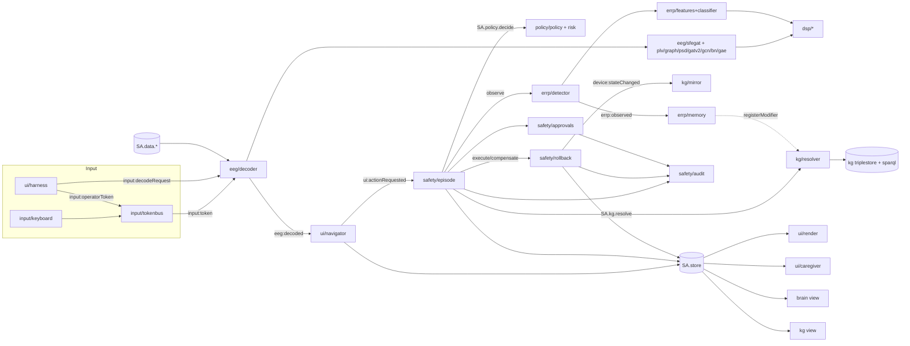
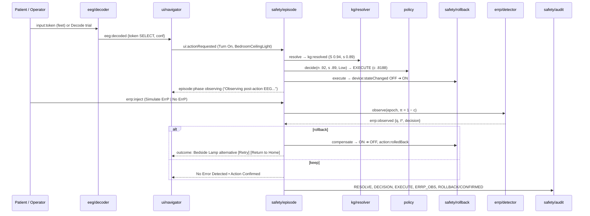

# SilentAssist POC — Architecture and FROZEN CONTRACTS

**Status:** FROZEN 2026-10-14 ~16:20 for the mid-evaluation build (2026-10-15). Source decisions: ADR 0001, 0002, 0003, 0004 (incl. its Addendum A), 0005. Where those ADRs disagree, the **Reconciliation** table (§0.3) is the ruling.
**Changing a contract:** only the contracts architect / orchestrator edits this file. A builder who needs a change writes a one-line request; until it is granted, code to the contract as written.
**Honesty:** EEG in the browser is Scripted (no EEG), Replay (real BCI IV-2a A01 session-E trials) or Synthetic (generated). The UI always says which. Nothing here claims clinical validity.

---

## 0. Ground rules

### 0.1 Runtime (CLAUDE.md §3)
- `POC/index.html` opens by double-click (`file://`), offline, in Edge/Chrome. No ES modules, `import(`, `fetch`, `XMLHttpRequest`, CDN URLs or web fonts. No build step.
- Every JS file is a classic IIFE. Exact opening and closing:
  ```js
  (function (root) {
    'use strict';
    var SA = root.SA = root.SA || {};
    SA.<ns> = SA.<ns> || {};
    /* ... */
  })(typeof window !== 'undefined' ? window : globalThis);
  ```
  Never assume `SA.x` exists at load time; read dependencies **lazily inside functions** (`SA.dsp.fft(...)` at call time), so load order mistakes fail loudly at first use, not at load.
- **No DOM / `document` / `navigator` / `localStorage` access at load time.** DOM work happens only inside `init()` functions called by `SA.app.start()` after `DOMContentLoaded` (Node loads every file with no `document`).
- `setTimeout`/`setInterval` are used **only** inside `core/clock.js`; everyone else uses `SA.clock.after(ms, fn)` (cancellable by Reset). Exception: `voice/speech.js` may use `setTimeout(0)` for the speak-after-cancel idiom and the 250/1000/3000 ms voice re-pick (ADR 0005 D16/D18).
- Hand-written file: target ≤ 400 lines, hard fail > 450. Generated `data/*.js` (line 1 contains `GENERATED`) exempt.
- All colours/spacing are CSS custom properties in `POC/css/tokens.css`. All tunables in `SA.config` (§5). Runtime-adjustable values (sliders, toggles, room) live in `SA.store`, never in config.

### 0.2 Isolation (enforced by grep tests)
1. **UI-side modules** (`ui/**`, `input/**`, `voice/**`, `brain/**`, `kg/kg-view.js`) talk to the rest **only** through `SA.bus` and `SA.store` (plus pure `SA.ui.format.*`, `SA.config`, `SA.data.montage`). They never reference `SA.eeg`, `SA.errp`, `SA.kg.resolver`, `SA.policy`, `SA.safety`. They request audit entries by emitting `audit:request`.
   - Exception: `brain/brain-graph-view.js` may read `SA.data.montage`; graphs it draws arrive in `eeg:decoded.graphs` / `eeg:exemplar` payloads.
2. **Domain modules** may call each other's **public APIs listed in §2** (e.g. `safety/episode` calls `SA.kg.resolve`, `SA.policy.decide`, `SA.errp.detector.observe`, `SA.safety.rollback.execute`, `SA.safety.audit.append`). Never private helpers.
3. Each `SA.store` top-level slice has exactly one writer (§4). `SA.store.set/patch` throw if `by` is not the slice owner.

### 0.3 Reconciliation of ADR conflicts (ruling; ADR 0004 Addendum A records it)

| Topic | ADR texts | Ruling (this file) |
|---|---|---|
| Builder ownership | 0004 D40 vs tonight's 8 builders | §1.2 table (tonight's builders) |
| Replay token path | 0004 D4 "every key is cued-decoded" vs 0005 D25 "keys stay scripted; a separate decode button" | **0005 D25 + cued pool of 0004 D4**: README keys/buttons always emit their labelled token with slider confidence (`decoded:false`) in every mode. Harness **"Decode trial ► inject token"** draws a trial (cue class round-robin or pinned trial), runs the real forward pass, and the **decoded** class acts even when wrong (`decoded:true`). |
| Neural slider in Replay | 0004 D5 disabled vs 0005 D25 used by keys | Enabled in all modes; captioned "applies to scripted tokens". |
| Screen ids | 0004 D16 `fan/ac/tv/brightness` vs 0005 D6 `devices/fan…` | **0005 D6 ids** (§6). |
| Navigation-mode key | 0004 `ui.navMode` vs 0005 `ui.audioMode` | **`ui.navMode ∈ {null,'visual','audio'}`** |
| Fan initial state | 0004 `speed:'off'` vs 0003 power OFF, speed unbound | **0003**: `{power:'off', speed:null}` |
| TV volume step | 0003: 5 vs 0005: 10 | **5** (device facts are 0003's remit), `SA.config.devices.tv.volumeStep` |
| AC/Fan/TV subtitles | 0003 vs 0005 | **0005 D7** strings |
| Policy event emitter | 0004 D13 `policy/policy` | `SA.policy.decide` is **pure**; `safety/episode` emits `policy:decided` |
| ErrP cost cells | 0002 D12 BFS-derived | Tonight: `SA.config.errp.costs` holds the ADR 0002 D13 values; classes without values are **flag-only** (documented gap). A selftest compares against `SA.nav.shortestPath` when present. |
| Montage | 0004 D34 MNE colin27_1005 vs task "hard-coded 10-20 table" | `data/montage-data.js` is a **generated hard-coded table**: EXPORT writes it from MNE 1.13.2 `colin27_1005` (installed in venv); header names the source. Never hand-typed in browser code. |
| Node runner | 0004 D29 `research/export/node_runner.js` vs task `research/tests/js/run_node.js` | **Both**: `research/tests/js/run_node.js` (CORE) is the generic loader + `load-only` + `cases`; it `module.exports = {loadPOC}`. `research/export/node_runner.js` (EXPORT) `require`s it for parity subcommands. |
| Weights namespace | task `SA.data.sfegat` | **`SA.data.sfegatWeights`** (0004 D9) |

---

## 1. Files, load order, ownership

### 1.1 `<script>` load order (exact; CORE writes these tags in `POC/index.html` in this order)

Every listed file MUST exist. Each builder creates **all its files as stubs first** (IIFE that registers its namespace and no-op `init`), then fills them.

```
js/core/namespace.js          CORE    SA, SA.version, SA.util (deepClone, deepFreeze, deepEqual, round)
js/config/initial-state.js    CORE    SA.config.initialState, SA.config.input, SA.config.devices
js/config/ui.js               UI      SA.config.ui, SA.config.voice
js/config/kg.js               KG      SA.config.kg
js/config/policy.js           KG      SA.config.policy
js/config/safety.js           SAFETY  SA.config.safety
js/config/errp.js             SAFETY  SA.config.errp
js/config/eeg.js              EEG     SA.config.eeg
js/core/bus.js                CORE    SA.bus
js/core/store.js              CORE    SA.store
js/core/clock.js              CORE    SA.clock
js/core/b64.js                CORE    SA.core.b64
js/core/reset.js              CORE    SA.core.reset
js/data/montage-data.js       EXPORT  SA.data.montage           (GENERATED)
js/data/sfegat-weights.js     EXPORT  SA.data.sfegatWeights     (GENERATED)
js/data/mi-replay.js          EXPORT  SA.data.miReplay          (GENERATED)
js/data/errp-model.js         ERRP    SA.data.errpModel         (GENERATED)
js/data/errp-replay.js        ERRP    SA.data.errpReplay        (GENERATED)
js/dsp/fft.js                 (frozen, as built — nobody edits)
js/dsp/butterworth.js         (frozen)
js/dsp/sosfilt.js             (frozen)
js/dsp/welch.js               (frozen)
js/dsp/hilbert.js             (frozen)
js/dsp/integrate.js           (frozen)
js/eeg/tensor.js              EEG
js/eeg/plv.js                 EEG
js/eeg/graph.js               EEG
js/eeg/psd-features.js        EEG
js/eeg/gatv2.js               EEG
js/eeg/gcn.js                 EEG
js/eeg/batchnorm.js           EEG
js/eeg/gae.js                 EEG
js/eeg/sfegat.js              EEG
js/eeg/synth.js               EEG
js/eeg/decoder.js             EEG
js/errp/features.js           SAFETY
js/errp/classifier.js         SAFETY
js/errp/detector.js           SAFETY
js/errp/memory.js             SAFETY
js/errp/synth.js              SAFETY
js/kg/ontology.js             KG      SA.kg.ontologyTTL (byte-identical to kg/silentassist.ttl)
js/kg/turtle.js               (frozen, as built)
js/kg/triplestore.js          (frozen)
js/kg/sparql.js               (frozen)
js/kg/resolver.js             KG
js/kg/mirror.js               KG
js/kg/kg-view.js              VIZ
js/brain/montage.js           VIZ
js/brain/brain-graph-view.js  VIZ
js/policy/risk.js             KG
js/policy/policy.js           KG
js/safety/audit.js            SAFETY
js/safety/rollback.js         SAFETY
js/safety/approvals.js        SAFETY
js/safety/episode.js          SAFETY
js/voice/speech.js            UI
js/input/tokenbus.js          CORE
js/input/keyboard.js          CORE
js/ui/format.js               UI
js/ui/screens.js              UI      SA.ui.screens + SA.nav (screen graph)
js/ui/render.js               UI
js/ui/navigator.js            UI
js/ui/components/pills.js     UI
js/ui/components/listbox.js   UI
js/ui/components/coglign-panel.js UI
js/ui/components/caption.js   UI
js/ui/components/observation.js UI   (observation band, S5 result, confirm/pending dialogs)
js/ui/harness.js              UI
js/ui/caregiver/dashboard.js  VIZ
js/ui/caregiver/queue.js      VIZ
js/ui/caregiver/gauges.js     VIZ
js/ui/caregiver/shadow-table.js VIZ
js/ui/caregiver/audit-view.js VIZ
js/selftest/selftest.js       CORE
js/selftest/cases/core.js     CORE
js/selftest/cases/ui.js       UI
js/selftest/cases/viz.js      VIZ
js/selftest/cases/kg.js       KG
js/selftest/cases/safety.js   SAFETY
js/selftest/cases/eeg.js      EEG
js/app.js                     CORE    SA.app.start()
```

CSS `<link>` order (all `POC/css/`): `tokens.css, base.css, layout.css, components.css, screens.css, harness.css` (UI), `caregiver.css` (VIZ).

### 1.2 Ownership (exclusive; touch only your files)

| Builder | Owns |
|---|---|
| **CORE** | `POC/index.html`, `POC/js/core/*`, `POC/js/config/initial-state.js`, `POC/js/input/*`, `POC/js/selftest/selftest.js`, `POC/js/selftest/cases/core.js`, `POC/js/app.js`, `research/tests/js/run_node.js`, `research/tests/js/core/*`, `research/scripts/run_selftest.py`, `research/scripts/screenshots.py`, `docs/verification/` |
| **UI** | `POC/js/ui/*` except `ui/caregiver/`, `POC/js/voice/*`, `POC/css/*` except `caregiver.css`, `POC/js/config/ui.js`, `POC/js/selftest/cases/ui.js`, `research/tests/js/ui/*` |
| **VIZ** | `POC/js/ui/caregiver/*`, `POC/js/brain/*`, `POC/js/kg/kg-view.js`, `POC/css/caregiver.css`, `POC/js/selftest/cases/viz.js`, `research/tests/js/viz/*` |
| **KG** | `kg/silentassist.ttl`, `kg/tests/*`, `POC/js/kg/{ontology,resolver,mirror}.js`, `POC/js/policy/*`, `POC/js/config/{kg,policy}.js`, `POC/js/selftest/cases/kg.js` |
| **SAFETY** | `POC/js/safety/*`, `POC/js/errp/*`, `POC/js/config/{safety,errp}.js`, `POC/js/selftest/cases/safety.js`, `research/tests/js/safety/*` |
| **EEG** | `POC/js/eeg/*`, `POC/js/config/eeg.js`, `POC/js/selftest/cases/eeg.js`, `research/tests/js/eeg/*` |
| **EXPORT** | `POC/js/data/{montage-data,sfegat-weights,mi-replay}.js`, `research/export/*` (incl. `jsdata.py`, `stubs.py`, `node_runner.js`), `research/tests/test_export_*.py`, `research/tests/test_sfegat_parity.py` |
| **ERRP** | `POC/js/data/{errp-model,errp-replay}.js`, `research/errp/*`, `research/configs/errp.yaml`, `research/tests/test_errp_*.py` |
| frozen | `POC/js/dsp/*`, `POC/js/kg/{turtle,triplestore,sparql}.js`, `research/sfegat/*` (SFE-GAT trainer only; Plan B is running — no heavy CPU jobs) |

### 1.3 Boot sequence (`SA.app.start(opts)`, on `DOMContentLoaded`; `opts.headless` = Node, see §8.1)
1. `SA.util.deepFreeze(SA.config)`.
2. `SA.store.reset()` (from `SA.config.initialState`; `prefs.reducedMotion` from `matchMedia('(prefers-reduced-motion: reduce)')`).
3. Call `init()` on each of these **if it exists** (try/catch each; an exception is `console.error`'d and counted by selftest), in this order:
   `SA.safety.audit, SA.kg.resolver, SA.kg.mirror, SA.errp.memory, SA.errp.detector, SA.eeg.decoder, SA.safety.rollback, SA.safety.approvals, SA.safety.episode, SA.voice.speech, SA.input.tokenbus, SA.input.keyboard, SA.ui.render, SA.ui.navigator, SA.ui.harness, SA.kg.view, SA.brain.view, SA.ui.caregiver`.
4. `SA.safety.audit.append('BOOT', {version: SA.version, decoderMode:'scripted'}, 'system')`.
5. `SA.bus.emit('app:ready', {})`.
6. If `location.search` contains `selftest=1`: `SA.selftest.run()`.

---

## 2. Module APIs (public; everything else is private)

Conventions: matrices are row-major `Float64Array` with explicit dims; channel-major EEG `X[c*T + t]`; µV for EEG; Hz; ms for timings; probabilities in [0,1] (display ×100). Every module with subscriptions or DOM exposes `init()` (idempotent) and, if it holds private state, subscribes to `demo:reset` to clear it.

### 2.1 Core (CORE)
- `SA.util`: `deepClone(o)`, `deepFreeze(o)`, `deepEqual(a,b) → bool`, `round(x, dp) → number` (`Math.round((x + Number.EPSILON·sign) × 10^dp) / 10^dp`), `uid(prefix) → 'ep-1'…` (counters reset on `demo:reset`).
- `SA.bus`: `on(evt, fn) → off()`, `once(evt, fn) → off()`, `emit(evt, payload)`, `clear()` (tests only). Synchronous, subscription order; an `emit` during dispatch is queued FIFO and drained after the current dispatch. Handler exceptions are caught, `console.error`'d and counted in `SA.bus.errorCount`. `SA.bus.log` keeps the last 200 `{evt, payload, ts}` (selftest reads it).
- `SA.store`: `get(path)` (dot path; objects returned as deep clones), `set(path, value, by)`, `patch(path, partialObj, by)` (shallow merge at path), `snapshot()` (deep clone of everything), `reset()` (deep clone of `SA.config.initialState`, keeps current `prefs.reducedMotion`), `owners(slice) → [tags]`. The ownership table is hard-coded in `store.js`: `ui:['ui']`, `prefs:['harness','ui']` (ui only for `prefs.voice` on the S1 SELECT), `decoder:['decoder','episode']` (episode only for `errpCursor`/`errpPin`), `context:['harness']`, `devices:['rollback']`, `episode:['episode']`, `approvals:['approvals']`, `errp:['errp-memory']`, `telemetry:['episode']`; `'core'` may write anything (reset only). Every write emits `store:changed {path, by}`. A write by a non-owner throws `Error('store: <by> may not write <slice>')`.
- `SA.clock`: `now() → ms` (demo clock; at reset = `Date.parse(SA.config.initialState.context.clock)`, then advances in real time × `speed`), `after(ms, fn) → handle` (real delay `ms / speed`), `cancel(handle)`, `cancelAll()`, `speed` (default 1; selftest sets 10), `iso() → 'YYYY-MM-DDTHH:MM:SS'`.
- `SA.core.b64`: `decodeF32(str) → Float64Array` (base64 → little-endian float32 → upcast float64), `decodeBytes(str) → Uint8Array`, `encodeF32(arr) → str` (tests). Callers decode lazily on first use and cache.
- `SA.core.reset()` — ADR 0004 D36, triggered by `demo:resetRequested`:
  1. `SA.clock.cancelAll()`;
  2. `bus.emit('demo:resetting', {})` → approvals mark pending real requests `APPROVAL_CANCELLED`; episode aborts any in-flight episode (`EPISODE_ABORTED`, no compensation);
  3. `SA.store.reset()`;
  4. `bus.emit('demo:reset', {resetSeq})` → KG reloads canonical TTL (restores 6/2/2 seed history), ErrP memory clears, decoder cursors/pins reset, navigator renders S1 focus 0, mode back to `scripted`;
  5. `SA.safety.audit.append('RESET', {prevHead}, 'operator')`.
- `SA.input.tokenbus`: `init()`; `emitToken(cls, source)` validates and emits `input:token`. Listens to `input:operatorToken {cls}` (from harness buttons) → `source:'operator'`. Also applies `harness:set` for `context.*` and `prefs.*` keys (store owner tag `'harness'`; emits `context:roomChanged` and requests a `ROOM` audit entry), and sets `html[data-reduced-motion]` lazily. Debounce `SA.config.input.minInterTokenMs` (250). While `store.ui.dashboardOpen` it drops tokens and emits `input:dropped {cls, reason:'dashboard'}`.
- `SA.input.keyboard`: `init()` attaches a capture-phase `keydown` on `window` (ADR 0005 D4). Map, README §2 exact:
  - `ArrowRight`, `d`, `D` → `right` / NEXT
  - `ArrowLeft`, `a`, `A` → `left` / PREV
  - `Enter`, `' '` (Space), `s`, `S` → `feet` / SELECT
  - `Escape`, `Backspace`, `w`, `W` → `tongue` / BACK
  - `c`, `C` → emits `ui:dashboardToggleRequested {}`
  - Ignores `repeat`, Ctrl/Alt/Meta and targets inside `input,select,textarea`. `preventDefault()` on Space, arrows, Enter, Esc, Backspace. While the dashboard is open, Enter/Space on a focused dashboard `<button>` stay native.
- `SA.selftest`: `register(domain, id, fn)` (`fn(t)` may return a Promise; `t.ok(cond, detail)`, `t.eq(a, b, detail)` (deepEqual), `t.near(a, b, tol, detail)`; a throw is a fail), `run(opts) → Promise<report>`, `report` (live). See §8.2.
- `SA.app.start()`: §1.3.

### 2.2 EEG (EEG builder) — float64 throughout; model constants come ONLY from `SA.data.sfegatWeights.manifest`
- `SA.eeg.tensor`: `linear(x, N, Fin, W, b, Fout) → Float64Array[N*Fout]` = `x·Wᵀ + b` for PyTorch `Linear` weight `W[Fout*Fin]` (b may be null); `relu(a)` (in place, returns a); `softmax(v) → Float64Array`; `argmax(v) → int`.
- `SA.eeg.plv.compute(X, C, T, opts) → Float64Array[C*C]`: per channel analytic signal (`SA.dsp.hilbert`), unit phasor (0 where |a| = 0), `P_ij = |mean_t u_i·conj(u_j)|`, symmetrised `0.5(P+Pᵀ)`, clipped to [0,1]. `opts = {band: null | [lo,hi], sos}`; `band:null` = broadband (as `research/sfegat/graph.plv`). With a band, filter first with `SA.dsp.sosfiltfilt(opts.sos, x)`.
- `SA.eeg.graph.build(P, C, opts) → {Z, mask, edges}`: whole-matrix z-score including the diagonal (mean and population std over all C² entries, `eps = 1e-8` added to std), then diag set to 0; `mask = Z > tau` (strict), diag false. `edges = {src: Int32Array, dst: Int32Array, w: Float64Array, n: E}` in **row-major order of the mask** (`src` = row, `dst` = col; PyG `edge_index[0] = src`; messages flow src → dst and aggregate at dst); `w = Z[src, dst]`.
- `SA.eeg.psdFeatures.compute(X, C, T, m) → Float64Array[C*B]`: for band k: `y = SA.dsp.sosfiltfilt(m.sos[k], x)`; `{f, Pxx} = SA.dsp.welch(y, {fs, nperseg, noverlap, window:'hann'})`; `SA.dsp.bandPower(f, Pxx, lo, hi)` (Simpson, closed edges). `log10` if `m.log10`. Units µV² (or log10 µV²).
- `SA.eeg.gatv2.forward(x, N, Fin, edges, W, opts) → Float64Array[N*H*Fo]`: PyG `GATv2Conv(Fin, Fo, heads=H, concat=True, negative_slope=0.2, add_self_loops=True, share_weights=False, bias=True)`. Self-loops: drop existing, add one per node (appended after the edges). `xl = lin_l(x)`, `xr = lin_r(x)`; for edge j→i and head h: `e = Σ_f att[h,f] · leakyReLU(xl_j[h,f] + xr_i[h,f])`; softmax over i's incoming edges (incl. self-loop); `out_i[h] = Σ α · xl_j[h]`; concat heads; `+ bias`. `W = {lin_l_w, lin_l_b, lin_r_w, lin_r_b, att /*[H*Fo]*/, bias /*[H*Fo]*/}`; `opts = {heads, outPerHead, negativeSlope}`.
- `SA.eeg.gcn.forward(x, N, Fin, edges, W, opts) → Float64Array[N*Fo]`: PyG `GCNConv(normalize=True, add_self_loops=True)`: self-loop weight 1, `deg_i = Σ_{j→i} w_ji` (incl. self-loop), `norm_ji = w_ji / √(deg_j · deg_i)`, `out_i = Σ norm_ji · lin(x_j)` then `+ bias`. `W = {lin_w, bias}`; `opts.useEdgeWeight` (from manifest; false → all w = 1).
- `SA.eeg.batchnorm.forward(x, N, F, W) → Float64Array`: eval mode `(x − running_mean)/√(running_var + eps) · weight + bias`; `eps` from manifest (`1e-5`).
- `SA.eeg.gae.mask(z, N, D, edges, eta) → {p: Float64Array[E], keep: Uint8Array[E], edges}`: `p_e = σ(z_src · z_dst)`, keep iff `p_e > eta` (strict); returns the kept sub-edge list (with their `w`).
- `SA.eeg.sfegat`:
  - `load(data = SA.data.sfegatWeights) → model` — decodes the blob once, maps tensors by exact `state_dict` name, **throws** on missing / extra / wrong-shape tensors.
  - `features(model, X, C, T) → {H, P}`; `forwardGraph(model, H, P) → result`; `forward(model, X, C, T) → result`.
  - `result = {logits: Float64Array[4], probs, probsCal: Float64Array[4] | null, pred, conf, calibrated: bool, graphs: [A0, A1, A2, A3] (each {src, dst, w, n}), edgeCounts: [4 ints], stages: {P, Z, H, h0, z1, z2, z3, p1, p2, p3}, elapsedMs}`.
  - Pipeline: `x = stem(H, A0)` (no activation) → for b = 1..3: `h = BN_b(ReLU(GATv2_b(x, A)))`, `z = BNz_b(ReLU(GCN_b(h, A)))`, `A ← gae.mask(z, A, eta)`, `x = h` → `ReLU(cls_gat(x, A3))` → `cls_bn` → mean over nodes → (dropout = identity) → `lin` → logits. `probsCal = softmax(logits / manifest.calibration.temperature)` when present; `conf = max(probsCal ?? probs)`; `calibrated` says which.
- `SA.eeg.synth.trial(cls, k) → {X: Float64Array[22*1000], C:22, T:1000, fs:250, cls, seed, id:'SYN-<cls>-<k>'}` (ADR 0004 D7, `mulberry32(SA.config.eeg.synth.seed + k)`). **Tier 3**.
- `SA.eeg.decoder`: `init()` subscribes `input:token`, `input:decodeRequest`, `harness:set` (keys `decoder.*` except `errpPin`; setting `decoder.sliders.semantic` also sets `semanticOverride:true`), `demo:reset`; for `input:token` it emits `eeg:decoded {decoded:false, conf: sliders.neural, probs:null, trial:null}` in every mode; for `input:decodeRequest` it runs `decodeTrial` (Replay/Synthetic only; disabled with a caption when data is missing/stub-only or `replayEnabled` is false); writes `decoder.catalog` and `decoder.dataStatus` at init. `decodeTrial(ref) → result` (sync; `ref = {trialId}` or `{cuedCls}`). Emits `eeg:decodeStart`, `eeg:decoded`, `decoder:modeChanged`, `eeg:exemplar`. It is the only module that reads `decoder.mode`.

### 2.3 ErrP (SAFETY builder) — ADR 0002 D13, D18, D24
- `SA.errp.features.extract(epoch, model = SA.data.errpModel) → {x: Float64Array[72], fczMinUv}`: decode `epoch.dataB64` (64 × 922, channel-major, µV) → CAR → per channel causal `SA.dsp.sosfilt(model.sos, x, zi)` with `zi[s] = model.ziUnit[s] × x[0]` → subtract the mean over `model.baseline` = `[b0, b1)` samples → mean over each of 9 `model.windows` `[w0, w1)` for each of the 8 channels `model.featureChannelIndex` → 72 features (order exactly as `model.featureOrder` / `research/errp/features.py`); `fczMinUv` = min of baseline-corrected filtered FCz over `model.fczWindow` `[i0, i1)`.
- `SA.errp.classifier`: `score(x, model) → w·x + b`; `platt(score, model) → qTr = 1/(1 + exp(A·score + B))`; `priorShift(qTr, piTr, pi) → q` (odds × `(pi/(1−pi)) / (piTr/(1−piTr))`); `lr(qTr, piTr) → Λ = qTr/(1−qTr) · (1−piTr)/piTr`.
- `SA.errp.detector`:
  - `threshold(costClass, tier) → tStar`: `fp / (fp + fn − tp)` from `SA.config.errp.costs[costClass]`; `Infinity` if the class is flag-only, missing, or `tStar ≥ 1`.
  - `observe(epoch, ctx) → result`; `ctx = {episodeId, costClass, tier, pi, approvedHigh, mode}`; `result = {episodeId, epochId, source:'synthetic'|'replay', score, qTr, q, lambda, tStar, pi, decision:'rollback'|'keep'|'flag'|'log', fczMinUv, label}`.
  - Rule: `approvedHigh` → `'log'`; else if `q > max(tStar, pi)` → `'rollback'` when tStar is finite and `mode === 'auto'`, otherwise `'flag'`; else `'keep'`. Scripted mode always passes `mode:'auto'`.
  - *Amendment 2026-10-14 (RT1-03):* for a flag-only class (tStar = Infinity) the rule above can never fire, so ADR 0002 D14/D15's flag outcome was unreachable. Added: else if tStar is Infinity and `q > max(SA.config.errp.flagOnlyThreshold (0.5), pi)` → `'flag'`. Flag-only classes still never roll back. Selftest `ui/flag-only-setting`.
  - Emits `errp:observed` (payload = result). Otherwise pure.
- `SA.errp.memory`: `init()` subscribes `errp:observed` (keeps records with decision rollback/flag and Λ > 1 in `store.errp.memory`) and registers `SA.kg.resolver.registerModifier('errpMemory', factor)`; `factor(entityId, command, room) → M ∈ [floor, 1]` (ADR 0002 D18); `hFlag(entityId, command, room) → M < penalty.hFlag`; `noteDecision(room, command)` (n_k += 1 for that context; called by the resolver); `clear()`.
- `SA.errp.synth`: `epoch(kind) → epoch` (`kind: 'error'|'correct'` → the two synthetic records in `SA.data.errpReplay`); `nextReplay(kind, cursor) → {epoch, cursor}` (real epochs; error → TP, TP, FN; correct → TN, TN, FP, round robin); `list() → [{id, source, category}]`.

### 2.4 KG and policy (KG builder) — ADR 0003
- `SA.kg.ontologyTTL`: string, byte-identical to `kg/silentassist.ttl`.
- `SA.kg.resolver` (+ alias `SA.kg.resolve = SA.kg.resolver.resolve`):
  - `init()`: `SA.kg.turtle.parse(SA.kg.ontologyTTL)` → `SA.kg.store.create(triples, {subClassOf:true})`; subscribes `demo:reset` (reload).
  - `resolve(req, ctx) → resolved` and emits `kg:resolved`. `req = {episodeId, kind:'device'|'preset', id, command, args}`; `ctx = {activeRoom, roomConfidence}`.
  - `registerModifier(name, fn(entityId, command, room) → factor)`; `lastQuery` (the exact SPARQL string executed); `cq(n) → {vars, rows}` for competency questions 1–16; `triples()` (the store; tests only).
  - Score `S = gate · clamp01(.35 f_T + .30 f_S + .20 f_X + .15 f_R)`, rounded once to 4 dp. `s = round2(S(actedOn) × roomConfidence)`; presets `s = 1.00`. Ranking uses `S' = S × Π modifiers` (alternative and display only; never `s`).
- `SA.kg.mirror`: `init()` subscribes `device:stateChanged` (rewrites state triples), `errp:observed` (adds `sa:ErrPObservation` / `sa:ErrPFeedback`), `action:confirmed` (appends a confirmed `sa:ActionExecution` for recency), `context:roomChanged`. `deviceStates() → {deviceId: {...}}` read back from triples (selftest equality with `store.devices`).
- `SA.policy.risk.assess(action, devices) → {tier:'Low'|'Medium'|'High', tierLabel:'Low: Autonomic'|'Medium: Guarded'|'High: Caregiver Approval', rule: null | {id:'thermal', text}, advisory: null | string, costClass}`. Tier map ADR 0003 D16; the thermal overlay applies to any resulting setpoint `< 18` or `> 30` (strict). Rule text example: `Setpoint 17°C is below the 18°C minimum`. Preset tier = max over non-no-op steps. `costClass` per §5.6.
- `SA.policy.decide(ctx) → {decision:'EXECUTE'|'CONFIRM'|'REJECT'|'CAREGIVER', reason, n, s, c, tier, trace:[string]}` — **pure, no emit**. `ctx = {n, s, tier, noop, noopReason, hFlag, ruleText}`. `n` rounded to 2 dp; `c = round4(n × s)`. Rules in order (ADR 0003 D13):
  1. noop → REJECT (`No change: <label> is already <state>`);
  2. `n < 0.40 || c < 0.50` → REJECT (`Not sure, please try again`);
  3. High → CAREGIVER;
  4. Medium: `c ≥ 0.85` → EXECUTE else CONFIRM;
  5. Low: `c ≥ 0.75` → EXECUTE else CONFIRM;
  6. EXECUTE and hFlag → CONFIRM.
  - Trace lines are display-ready, e.g. `c = 0.92 × 0.89 = 0.8188 ≥ 0.75 (Low) → EXECUTE`.

### 2.5 Safety (SAFETY builder)
- `SA.safety.audit`:
  - `init()`; subscribes `audit:request {type, data, actor}`, `audit:verifyRequested`, `audit:tamperRequested {seq}`.
  - `append(type, data, actor) → Promise<{seq, hash}>` (serialised promise queue). Entry `{seq, ts: SA.clock.iso(), type, actor, data, prevHash, hash}`. `hash` = SHA-256 hex (`crypto.subtle`) of the canonical JSON (sorted keys; µV values to 1 dp) of the entry without `hash`. Fallback: FNV-1a 64-bit hex when `crypto.subtle` is missing. Genesis `prevHash = '0' × 64`. Emits `audit:appended {seq, type, hash, entry}`.
  - `entries() → [entry]` (clone); `head() → {seq, hash}`; `verify() → Promise<{ok, brokenAt, algo:'SHA-256'|'FNV-1a'}>` (emits `audit:verified`); `tamperDemo(seq)` (mutates that stored entry's data in place, then re-verifies).
  - The chain is **not** in the store and **never** truncated; Reset appends `RESET`.
  - Types: `BOOT, TOKEN, DECODE, MODE, ROOM, RESOLVE, DECISION, CONFIRM_ACCEPTED, CONFIRM_CANCELLED, EXECUTE, ERRP_OBS, CONFIRMED, ROLLBACK, FLAGGED, APPROVAL_REQUESTED, APPROVED, REJECTED, WITHDRAWN, EXPIRED, APPROVAL_CANCELLED, EPISODE_ABORTED, RESET, TAMPER_DEMO`. Actors: `'patient'` (decoded/keyboard tokens), `'operator'` (harness), `'operator-harness'` (truth metadata), `'caregiver'`, `'system'`.
- `SA.safety.rollback`: `plan(action, devices) → steps [{deviceId, before, after}]` (full device objects; no-op steps omitted; presets expand per ADR 0003 D18); `execute(episodeId, steps, actor) → sagaId` (applies each step to `store.devices`, emits `device:stateChanged` per step, then `action:executed`); `compensate(episodeId, sagaId) → steps` (reverse order; restores `before` only where the device still equals `after`; emits `device:stateChanged` per step, then `action:rolledBack`).
- `SA.safety.approvals`: `request(episodeId, action, reasonText) → approvalId` (adds to `store.approvals`, emits `approval:requested`, expiry after `SA.config.safety.approvalTimeoutMs` → `expired`); subscribes `caregiver:approve`, `caregiver:reject`, `ui:requestWithdrawn`, `demo:resetting`; emits `approval:resolved {approvalId, episodeId, outcome:'approved'|'rejected'|'withdrawn'|'expired'|'cancelled', actor}`. Approving the seeded `ap-seed-1` runs the real path (execute + log-only ErrP + audit with `seeded:true`).
- `SA.safety.episode`: the per-action state machine. `init()` subscribes `eeg:decoded` (remembers the last SELECT's `conf`), `ui:actionRequested`, `ui:confirmAccepted`, `ui:confirmCancelled`, `ui:requestWithdrawn`, `ui:outcomeChoice`, `errp:inject`, `approval:resolved`, `demo:resetting`. `current() → store.episode`. Flow:
  1. `ui:actionRequested` → phase `resolving` → `SA.kg.resolve(req, {activeRoom, roomConfidence: SA.config.kg.roomConfidence})` → phase `deciding` → `SA.policy.risk.assess` → `SA.policy.decide({n: lastSelectConf, s: decoder.sliders.semanticOverride ? decoder.sliders.semantic : resolved.semanticConfidence, tier, noop, noopReason, hFlag, ruleText})` → write `store.telemetry` + `store.episode` → emit `policy:decided`; audit `RESOLVE`, `DECISION`. `trueCls`/`correct` are **never** passed to `decide` (ADR 0004 D5).
  2. REJECT → phase `idle`, `voice:say` (safety). CONFIRM → phase `confirm`. CAREGIVER → `SA.safety.approvals.request` → phase `pendingCaregiver`. EXECUTE → after `SA.config.ui.decisionDwellMs` → execute.
  3. Execute: `SA.safety.rollback.execute` → phase `observing` → emit `errp:observeStart {episodeId, costClass, tier, pi, durationMs: SA.config.errp.observeMs}`. If `prefs.errpAutoConfirm`, schedule `errp:inject {kind:'correct', source:'auto'}` after `SA.config.errp.autoConfirmDelayMs`.
  4. `errp:inject {kind}` while observing → epoch: Scripted/Synthetic `SA.errp.synth.epoch(kind)`; Replay `SA.errp.synth.nextReplay(kind, store.decoder.errpCursor[kind])` unless `decoder.errpPin`. Auto-confirm always uses the synthetic-correct epoch. Then `SA.errp.detector.observe(epoch, {pi: max(SA.config.errp.piFloor, 1 − c), ...})`.
  5. `keep` → audit `CONFIRMED`, emit `action:confirmed`, outcome `confirmed`. `rollback` → `compensate`, audit `ROLLBACK`, outcome `rolledBack`, `alternative` = best of `resolved.ranked` re-ranked by current modifiers **excluding the acted-on entity** (lights; presets re-issue themselves). A second rollback in one episode → outcome `rolledBackHome`. `flag`/`log` → audit `ERRP_OBS` (+ `FLAGGED`), emit `action:flagged`, no state change. An injection whose decision disagrees with its kind shows `detector disagreed (q = …)` — never forced.
  6. `ui:outcomeChoice {choice:'retry'}` → a new episode for the alternative (or the same preset), full policy; `'home'` → idle.

### 2.6 UI (UI builder)
- `SA.ui.format` (pure, DOM-free; also used by selftest and VIZ):
  - `hubSubtitle(itemId, devices) → string`; `fixtureState(device) → 'ON'|'OFF'`; `transition(step) → 'Bedroom Ceiling Light: OFF ➔ ON'`;
  - `pct(x) → '92%'`; `score(x) → '0.94'`; `tierLabel(tier)`; `decisionChip(d) → '✓ EXECUTE'|'? CONFIRM'|'✕ REJECT'|'⚑ CAREGIVER APPROVAL'`;
  - `errpStatus(uv) → 'Possible Error Detected • ErrP Deflection at FCz (-8.4 µV)'` (hyphen-minus U+002D; `uv.toFixed(1)`; micro sign U+00B5);
  - `eegPill(decoderState) → 'EEG: Simulation Mode' | 'EEG: Replay Mode (BCI IV-2a A01, session E)' | 'EEG: Synthetic Mode (generated, seed n)'`; `decoderPill(state) → 'Decoder: Scripted' | 'Decoder: Replay · PRELIMINARY (Plan B)' | …`.
- `SA.ui.screens`: the declarative screen table (ADR 0005 D6) — `{[screenId]: {title, ariaLabel, columns, items(state) → [{id, title, subtitle, disabled}], select(item, state) → {goto, focus} | {action}, back(state) → {goto, focus} | {noop: text}, entryFocus(state) → index}}`.
- `SA.nav`: `graph` (`{[screenId]: [targetIds]}`), `shortestPath(from, to) → [screenIds]` (BFS). DOM-free.
- `SA.ui.navigator`: `init()`; **consumes only `eeg:decoded` as tokens**; also subscribes episode/approval/outcome events, `ui:dashboardToggleRequested`, `demo:reset`. Sole writer of `store.ui`. Emits the `ui:*` events (§3) and `voice:say`, `audit:request` (`TOKEN`, `CONFIRM_CANCELLED` re-prompt counts). `refocus()`.
- `SA.ui.render`: `init()`; subscribes `store:changed` (rAF-batched); renders top bar, stage, CogLign panel, harness state.
- `SA.ui.components.{pills, listbox, coglignPanel, caption, observation}`: `render(el, model)`.
- `SA.ui.harness`: `init()`; renders and wires the dock; emits `input:operatorToken {cls}`, `input:decodeRequest {cuedCls | trialId}`, `errp:inject {kind, source:'operator'}`, `harness:set {key, value}`, `demo:resetRequested {}`. Buttons `tabindex="-1"`, `mousedown → preventDefault()`.
- `SA.voice.speech`: `init()`; subscribes `voice:say`; `say(display, speech, priority)`; always writes `#sa-status` (priority `'nav'`) or `#sa-alert` (priority `'safety'`); speaks local voices only (`allowOnline:false`); `SA.voice.lexicon` (ADR 0005 D19); emits `voice:status {available, voiceName}`. Never writes the store.

### 2.7 Viz (VIZ builder)
- `SA.kg.view`: `init()`; inline SVG in `#sa-kg-view`; subscribes `kg:resolved`, `errp:observed`, `demo:reset`; ADR 0005 D24 (≤ 8 nodes; `1st · 0.94`, `2nd · 0.88`, `3rd · 0.38`).
- `SA.brain.montage`: `positions() → [{name, idx, x, y}]` from `SA.data.montage` (unit head circle, +y = nose); `index(name)`. FCz = 3, Cz = 9 (0-based; paper Fig. 2a numbers 4 and 10).
- `SA.brain.view`: `init()`; SVGs in `#sa-brain-view` and `#cv-brain`; subscribes `eeg:decoded` (animate `graphs` evo0 → evo3 at `--dur-evo-step` 700 ms; discrete under reduced motion), `eeg:exemplar`, `decoder:modeChanged`, `errp:observeStart` (FCz/Cz radar ring). Captions per ADR 0005 D24; stub caption `STUB DATA — not model output`.
- `SA.ui.caregiver`: `init()`; renders `#sa-caregiver` when `store.ui.dashboardOpen`; sub-renderers `SA.ui.caregiver.{queue, gauges, shadowTable, auditView}`. Emits `caregiver:approve`, `caregiver:reject`, `audit:verifyRequested`, `audit:tamperRequested`. Reads `store.approvals`, `store.devices`, `store.telemetry`, `store.errp`, `store.decoder`, and the audit entries carried in `audit:appended` payloads.

---

## 3. Bus event catalogue (FROZEN; payloads are the minimum; extra fields allowed)

`ts` = `SA.clock.now()` is added by emitters where listed. "Only emitter" is binding.

| Event | Payload | Only emitter | Listeners |
|---|---|---|---|
| `app:ready` | `{}` | app | selftest |
| `input:operatorToken` | `{cls}` | ui/harness | input/tokenbus |
| `input:token` | `{cls:'left'\|'right'\|'feet'\|'tongue', token:'PREV'\|'NEXT'\|'SELECT'\|'BACK', source:'keyboard'\|'operator'\|'auto', ts}` | input/tokenbus | eeg/decoder |
| `input:dropped` | `{cls, reason}` | input/tokenbus | ui/navigator (caption) |
| `input:decodeRequest` | `{cuedCls}` or `{trialId}` | ui/harness | eeg/decoder |
| `eeg:decodeStart` | `{mode, cuedCls, trialId}` | eeg/decoder | ui/navigator (lockout "Decoding…"), brain view |
| `eeg:decoded` | `{token, cls, conf, probs\|null, calibrated, decoded:bool, mode, source, cuedCls, trial:{id, subject, session, index, trueCls}\|null, correct:bool\|null, graphs:[A0..A3]\|null, edgeCounts\|null, preliminary, stub, ts}` | eeg/decoder | ui/navigator, safety/episode (conf), brain view, ui/harness (decode strip) |
| `eeg:exemplar` | `{trialId, graphs, edgeCounts, caption}` | eeg/decoder | brain view |
| `decoder:modeChanged` | `{mode, prev}` | eeg/decoder | ui, brain view, selftest |
| `harness:set` | `{key, value}`; keys `decoder.mode`, `decoder.sliders.neural`, `decoder.sliders.semantic`, `decoder.pin`, `decoder.errpPin`, `context.activeRoom`, `prefs.voice`, `prefs.decodeAnimation`, `prefs.errpAutoConfirm`, `prefs.reducedMotion` | ui/harness | slice owner applies it: `decoder.*` → eeg/decoder (`errpPin` → safety/episode); `context.*`, `prefs.*` → input/tokenbus (owner tag `'harness'`) |
| `context:roomChanged` | `{room, prev, source}` | input/tokenbus | kg/mirror, audit (`ROOM`) |
| `ui:dashboardToggleRequested` | `{}` | input/keyboard, ui (top-bar switch) | ui/navigator |
| `ui:dashboardToggled` | `{open}` | ui/navigator | ui/caregiver, input/tokenbus |
| `ui:focusChanged` | `{screen, index, itemId}` | ui/navigator | voice (via navigator `voice:say`), kg view |
| `ui:screenChanged` | `{from, to}` | ui/navigator | selftest |
| `ui:actionRequested` | `{target:{kind:'device'\|'preset', id}, command, args, origin:{screen, index}}` | ui/navigator | safety/episode |
| `ui:confirmAccepted` / `ui:confirmCancelled` | `{episodeId}` | ui/navigator | safety/episode |
| `ui:requestWithdrawn` | `{episodeId, approvalId}` | ui/navigator | safety/approvals, safety/episode |
| `ui:outcomeChoice` | `{episodeId, choice:'retry'\|'home'\|'continue'}` | ui/navigator | safety/episode |
| `kg:resolved` | `{episodeId, kind, command, intentLabel:'Turn On Light', actedOn:{id, iri:':BedroomCeilingLight', label, score}, ranked:[{id, iri, label, score, scorePenalised, features:{fT,fS,fX,fR}, modifiers:{errpMemory}}], kgTop:{id, iri, score}, noop, noopReason, semanticConfidence, roomConfidence, spatialContext:'Master Bedroom (Active User Room)', hFlag, query:{text, elapsedMs}, explanation:[string]}` | kg/resolver | safety/episode, ui (panel), kg view |
| `policy:decided` | `{episodeId, decision, reason, n, s, c, tier, tierLabel, rule, advisory, trace:[string]}` | safety/episode | ui (panel, chips), audit, caregiver gauges |
| `episode:phase` | `{episodeId, phase, prev}` | safety/episode | ui/navigator |
| `action:executed` | `{episodeId, sagaId, steps:[{deviceId, before, after}], actor}` | safety/rollback | ui, audit |
| `device:stateChanged` | `{deviceId, before, after, cause:'execute'\|'compensate'}` | safety/rollback | kg/mirror, ui, caregiver shadow table |
| `errp:inject` | `{kind:'error'\|'correct', source:'operator'\|'auto'}` | ui/harness, safety/episode (auto-confirm only) | safety/episode |
| `errp:observeStart` | `{episodeId, costClass, tier, pi, durationMs}` | safety/episode | ui (observing), brain view (radar) |
| `errp:observed` | detector `result` (§2.3) | errp/detector | safety/episode, errp/memory, kg/mirror, kg view, caregiver gauges |
| `action:confirmed` | `{episodeId, sagaId}` | safety/episode | kg/mirror, ui |
| `action:rolledBack` | `{episodeId, sagaId, steps, alternative:{id, label, score}\|null}` | safety/rollback (steps) — episode adds `alternative` in `store.episode` | kg/mirror, ui |
| `action:flagged` | `{episodeId, reason:'flag'\|'setting'\|'log'}` | safety/episode | ui |
| `approval:requested` | `{approvalId, episodeId, action, reason, seeded}` | safety/approvals | caregiver queue, voice |
| `approval:resolved` | `{approvalId, episodeId, outcome, actor}` | safety/approvals | safety/episode, ui/navigator, caregiver |
| `caregiver:approve` / `caregiver:reject` | `{approvalId}` | ui/caregiver | safety/approvals |
| `audit:request` | `{type, data, actor}` | any UI-side module | safety/audit |
| `audit:appended` | `{seq, type, hash, entry}` | safety/audit | caregiver audit view |
| `audit:verifyRequested` / `audit:tamperRequested` | `{}` / `{seq}` | ui/caregiver | safety/audit |
| `audit:verified` | `{ok, brokenAt, algo}` | safety/audit | caregiver audit view |
| `voice:say` | `{display, speech?, priority:'nav'\|'safety'}` | any module | voice/speech |
| `voice:status` | `{available, voiceName}` | voice/speech | ui (voice pill) |
| `store:changed` | `{path, by}` | core/store | ui/render, caregiver |
| `demo:resetRequested` | `{}` | ui/harness | core/reset |
| `demo:resetting` | `{}` | core/reset | approvals, episode |
| `demo:reset` | `{resetSeq}` | core/reset | every module with private state |
| `selftest:done` | `{pass, fail}` | selftest | — |

---

## 4. `SA.store` schema — exact initial state (`SA.config.initialState`, CORE writes it in `config/initial-state.js`)

```js
SA.config.initialState = {
  ui: {                                   // owner 'ui' (ui/navigator)
    screen: 'S1', focus: { S1: 0 }, focusMemory: {},
    subState: 'list',                     // 'list'|'decoding'|'confirm'|'pending'|'observing'|'outcome'
    dashboardOpen: false, navMode: null,  // null|'visual'|'audio'
    lockout: false, alert: null, caption: '', repromptCount: 0
  },
  prefs: {                                // owner 'harness' (input/tokenbus applies harness:set); 'ui' may set voice on S1 SELECT
    voice: false, decodeAnimation: true, errpAutoConfirm: false, reducedMotion: false
  },
  decoder: {                              // owner 'decoder' (eeg/decoder); errpCursor/errpPin owner 'episode'
    mode: 'scripted',
    sliders: { neural: 0.92, semantic: 0.89, semanticOverride: false },
    cursor: { left: 0, right: 0, feet: 0, tongue: 0 }, pin: null,
    errpCursor: { error: 0, correct: 0 }, errpPin: null,
    last: null, catalog: [], dataStatus: { weights: 'missing', replay: 'missing', errp: 'missing' }
  },
  context: { activeRoom: 'MasterBedroom', user: 'Patient', clock: '2026-03-01T21:00:00' },  // owner 'harness'
  devices: {                              // owner 'rollback' (safety/rollback); ids = KG local names
    BedroomCeilingLight: { kind: 'light', label: 'Bedroom Ceiling Light', room: 'MasterBedroom', order: 1, power: 'off', brightness: 100 },
    BedsideLamp:         { kind: 'light', label: 'Bedside Lamp',          room: 'MasterBedroom', order: 2, power: 'off', brightness: 100 },
    LivingRoomLight:     { kind: 'light', label: 'Living Room Light',     room: 'LivingRoom',    order: 3, power: 'on',  brightness: 100 },
    CeilingFan:     { kind: 'fan', label: 'Ceiling Fan',     room: 'MasterBedroom', power: 'off', speed: null },        // speed null|'low'|'medium'|'high'
    AirConditioner: { kind: 'ac',  label: 'Air Conditioner', room: 'MasterBedroom', power: 'on', setpoint: 24, mode: 'cool' }, // mode 'cool'|'fan'|'dry'
    SmartTV:        { kind: 'tv',  label: 'Smart TV',        room: 'MasterBedroom', power: 'standby', channel: 1, volume: 20 } // power 'standby'|'on'
  },
  episode: { id: null, phase: 'idle' },   // owner 'episode'; while active also: action, origin, resolved, decision, steps, sagaId, observation, outcome, alternative, rollbacks
  approvals: [                            // owner 'approvals'
    { id: 'ap-seed-1', seeded: true, episodeId: null, status: 'pending',
      action: { kind: 'device', id: 'AirConditioner', command: 'SetTemperature', args: { value: 16 } },
      intentLabel: 'Set Temperature 16°C', n: 0.92, s: 0.95,
      reason: 'Setpoint 16°C is below the 18°C minimum', label: 'Example request (seeded by Reset Demo)' }
  ],
  errp: { memory: [] },                   // owner 'errp-memory'
  telemetry: { n: null, s: null, c: null, tier: null, lastDecision: null, lastQ: null, lastErrpDecision: null } // owner 'episode'
};
```

- Audit chain is **outside** the store. Selftest equality after Reset excludes only `prefs.reducedMotion`.
- Reset also sets `decoder.mode = 'scripted'`, sliders 92/89, room Master Bedroom, toggles default.
- Display strings derive from the store via `SA.ui.format` (e.g. hub `1 Active of 3`, `Ceiling Fan: OFF`, `24°C • Cool Mode`, `Smart TV: Standby`, `4 Multi-Device Semantic Routines`).

---

## 5. `SA.config` (deep-frozen at start; one file per owner)

### 5.1 `config/initial-state.js` (CORE)
`SA.config.initialState` (§4); `SA.config.input = {minInterTokenMs: 250}`; `SA.config.devices = {brightnessLevels: [25, 50, 75, 100], fanSpeeds: ['low','medium','high'], ac: {min: 16, max: 32, step: 1, modes: ['cool','fan','dry']}, tv: {chMin: 1, chMax: 99, volMin: 0, volMax: 100, volumeStep: 5}}`.

### 5.2 `config/ui.js` (UI)
```js
SA.config.ui = {
  wrap: true, decisionDwellMs: 800, kgPrefocus: false, thermalAdvisory: { enabled: false },
  strings: {   // README bytes, verbatim
    pillEeg: 'EEG: Simulation Mode', pillEnv: 'Environment: Smart-Home Simulator',
    dashboardSwitch: 'Caregiver Dashboard',
    btnNext: 'Right Hand ► Next', btnPrev: 'Left Hand ◄ Previous', btnSelect: 'Both Feet ✓ Select', btnBack: 'Tongue ✕ Back',  // rendered with .sa-bracketed
    btnNoErrp: 'No ErrP', btnSimErrp: 'Simulate ErrP', btnRetry: 'Retry', btnHome: 'Return to Home', btnApprove: 'Approve', btnReject: 'Reject',
    s1Title: 'Mode Selection', s1Visual: 'Visual Navigation', s1Audio: 'Audio-Assisted Navigation',
    s2Title: 'Assistive Home Hub', hubLights: 'Lights', hubFans: 'Fans', hubAc: 'Air Conditioner', hubTv: 'TV & Media', hubPresets: 'Presets',
    presetsSub: '4 Multi-Device Semantic Routines',
    s3Title: 'Lights Fixtures', s4Title: 'Action Selection & Context Reasoning Panel',
    actTurnOn: 'Turn On', actTurnOff: 'Turn Off', actBrightness: 'Adjust Brightness', actBack: 'Back',
    observing: '“Observing post-action EEG...”',
    noErrp: 'No Error Detected • Action Confirmed',
    errpPrefix: 'Possible Error Detected • ErrP Deflection at FCz (', rolledBack: 'Action Rolled Back',
    s6Title: 'Semantic Presets', presets: ['Night Mode', 'All Lights Off', 'Cooling Mode', 'Watch TV'],
    panel: { intent: 'Decoded Intent', space: 'Spatial Context', entity: 'Resolved Entity', sparql: 'SPARQL Match',
             telemetry: 'Confidence Telemetry', neural: 'Neural MI', semantic: 'Semantic Context', risk: 'Risk Tier', decision: 'Policy Decision' },
    harnessLabel: 'Operator Harness — not patient-facing',
    caregiverBanner: 'Caregiver view — simulated, no authentication'
  }
};
SA.config.voice = { allowOnline: false, maxChars: 160, rate: 0.95, pitch: 1.0, lang: 'en-US', repickMs: [250, 1000, 3000] };
```

### 5.3 `config/kg.js` (KG)
`SA.config.kg = {weights: {type: .35, space: .30, state: .20, recency: .15}, recencyWindow: 10, recencyEmpty: 'uniform', roomConfidence: .95, rooms: {MasterBedroom: 'Master Bedroom', LivingRoom: 'Living Room'}}`.

### 5.4 `config/policy.js` (KG)
```js
SA.config.policy = { combine: 'product', reject: { cMin: .50, nMin: .40 }, execute: { low: .75, medium: .85 },
  noopGuard: true, maxAlternativesPerEpisode: 1, approvedHighErrp: 'log', confirmTokenMinConf: .60, confirmTimeoutMs: 0,
  thermal: { min: 18, max: 30, advisory: [20, 26], advisoryEscalates: false },
  tierLabels: { Low: 'Low: Autonomic', Medium: 'Medium: Guarded', High: 'High: Caregiver Approval' },
  tiers: { light: 'Low', fan: 'Low', tv: 'Low', ac: 'Medium' },
  presetTiers: { NightMode: 'Medium', AllLightsOff: 'Low', CoolingMode: 'Medium', WatchTV: 'Low' } };  // asserted == computed
```

### 5.5 `config/safety.js` (SAFETY)
`SA.config.safety = {approvalTimeoutMs: 300000, hashAlgo: 'SHA-256', fallbackAlgo: 'FNV-1a', maxRollbacksPerEpisode: 1}`.

### 5.6 `config/errp.js` (SAFETY) — ADR 0002 D12–D14, D18, D24
```js
SA.config.errp = { observeMs: 1000, autoConfirmDelayMs: 1500, mode: 'auto', piFloor: 0.02, canonicalPi: 0.181,
  penalty: { gamma: 0.5, floor: 0.5, halfLife: 20, hFlag: 0.9 },
  costs: {                                    // nominal MI tokens; t* = fp/(fp+fn-tp)
    'light-select':   { fp: 5, fn: 7,  tp: 2.92 },   // t* = 0.5507 (README S5)
    'preset':         { fp: 5, fn: 15, tp: 3 },      // t* = 0.2941
    'setting-medium': { fp: 1, fn: 6,  tp: 2 },      // t* = 0.2 (AC setpoint/mode/power in band)
    'setting':        null,                          // Low settings (brightness, fan, TV ch/vol): flag only
    'power':          null                           // fan/TV power: flag only tonight (BFS cells not derived — gap)
  } };
```
`costClass` (from `SA.policy.risk.assess`): light TurnOn/TurnOff → `light-select`; brightness, fan speed/off, TV channel/volume → `setting`; TV power → `power`; any AC command → `setting-medium`; preset → `preset`. Approved High actions → detector `ctx.approvedHigh = true` → `log`.

### 5.7 `config/eeg.js` (EEG)
`SA.config.eeg = {decodeAnimMs: 1600, replayEnabled: true, scriptedExemplar: 'auto', synthEnabled: false, synth: {seed: 20261015, nEval: 40, sigmaMm: 30}, classes: ['left','right','feet','tongue'], tokenOf: {left: 'PREV', right: 'NEXT', feet: 'SELECT', tongue: 'BACK'}}`. Model hyperparameters (τ, η, bands, sos, nperseg, temperature, class order) are **never** here — only in the data manifests.

---

## 6. Screens, DOM contract, HTML skeleton

### 6.1 Screen graph (ADR 0005 D6; ids are binding)

| id | Title | Items (in order) | SELECT | BACK |
|---|---|---|---|---|
| `S1` | Mode Selection | Visual Navigation, Audio-Assisted Navigation | → `S2` (sets `ui.navMode`; Audio also sets `prefs.voice`) | no-op, says "This is the first screen" |
| `S2` | Assistive Home Hub | Lights `n Active of 3`, Fans `Ceiling Fan: OFF`, Air Conditioner `24°C • Cool Mode`, TV & Media `Smart TV: Standby`, Presets `4 Multi-Device Semantic Routines` | Lights → `S3`, Fans → `devices/fan`, AC → `devices/ac`, TV → `devices/tv`, Presets → `S6` | → `S1` |
| `S3` | Lights Fixtures | Bedroom Ceiling Light `OFF`, Bedside Lamp `OFF`, Living Room Light `ON` (no Back card) | → `S4` (fixture) | → `S2` focus Lights |
| `S4` | Action Selection & Context Reasoning Panel | Turn On, Turn Off, Adjust Brightness, Back | On/Off → `ui:actionRequested` → episode → `S5`; Brightness → `lights/brightness`; Back = BACK | → `S3` focus fixture |
| `lights/brightness` | Adjust Brightness | 25%, 50%, 75%, 100%, Back | action, inline observation | → `S4` |
| `devices/fan` | Fans | Off, Low, Medium, High, Back | action, inline | → `S2` focus Fans |
| `devices/ac` | Air Conditioner | Power, Temp −, Temp +, Mode: Cool, Mode: Fan, Mode: Dry, Back | action, inline | → `S2` focus AC |
| `devices/tv` | TV & Media | Power, Channel −, Channel +, Volume −, Volume +, Back | action, inline | → `S2` focus TV |
| `S5` | Action Result | observing: no listbox, locked; outcome cards: success `Continue`, `Return to Home`; rollback `[Retry]`, `[Return to Home]` | per ADR 0005 D8 | success: Continue; rollback: Return to Home |
| `S6` | Semantic Presets | Night Mode, All Lights Off, Cooling Mode, Watch TV | policy → diff preview (= confirm) → `S5` | → `S2` focus Presets |
| sub-states | `confirm`, `pending` dialogs render over the current screen (`ui.subState`) | | SELECT confirms / re-prompts | BACK cancels / withdraws |
| `caregiver` | overlay (`ui.dashboardOpen`), not in the patient graph | | | `C` closes |

### 6.2 DOM ids and classes (selftest relies on these; never rename)

| Region | Selector | Notes |
|---|---|---|
| root | `#sa-app` | `data-screen="S1"`, `data-decoder-mode`, `data-reduced-motion` on `html` |
| top bar | `#sa-topbar` → `#sa-title`, `#pill-eeg`, `#pill-env`, `#pill-decoder`, `#pill-voice`, `button#btn-caregiver` | `#pill-eeg` text exactly `EEG: Simulation Mode` in Scripted |
| patient stage | `#sa-stage` → `#sa-screen-title`, `#sa-alert` (`role=alert`), `#sa-observation`, `#sa-listbox` (`role=listbox`, `tabindex=0`, `aria-activedescendant`), `#sa-position` ("n of m"), `#sa-result` (S5: `#sa-result-transition`, `#sa-result-status`, `#sa-result-alt`), `#sa-dialog` (confirm/pending, `role=dialog`), `#sa-status` (caption, `role=status aria-live=polite aria-atomic=true`) | |
| cards | `.sa-card[role=option]` with `id="opt-<screen>-<itemId>"`, `data-item-id`, `.is-focused` + `aria-selected=true` on exactly one; children `.sa-focus-marker` ("● Focused"), `.sa-card-title`, `.sa-card-sub` | screen ids with `/` become `-` in element ids |
| bracketed labels | `.sa-bracketed` | CSS adds `[` `]`; textContent has no brackets |
| right rail | `#sa-rail` → `#sa-coglign` with `#cl-intent`, `#cl-space`, `#cl-entity`, `#cl-sparql-score`, `#cl-neural`, `#cl-semantic`, `#cl-risk`, `#cl-decision`, `#cl-kgtop`, `#cl-trace`, `details#cl-sparql > pre#cl-sparql-text`; `#sa-graphs` → `#sa-kg-view`, `#sa-brain-view` | values only (labels are separate `<span>`s) |
| caregiver | `#sa-caregiver` (`hidden` unless open) → `#cv-banner`, `#cv-patient`, `#cv-queue`, `#cv-gauges`, `#cv-shadow`, `#cv-brain`, `#cv-audit` → `#cv-audit-badge`, `#cv-audit-head`, `#cv-audit-list`, `button#cv-verify`, `button#cv-tamper`; approval buttons `button.cv-approve[data-approval-id]`, `button.cv-reject[data-approval-id]` | |
| harness | `#sa-harness` → `#hz-label`, `button#hz-next`, `#hz-prev`, `#hz-select`, `#hz-back` (README order: Next, Previous, Select, Back), `#hz-noerrp`, `#hz-simerrp`, `select#hz-mode`, `button#hz-more`, `#hz-dataline`, `#hz-decode-strip`; expanded `#hz-expanded` → `input#hz-neural`, `input#hz-semantic`, `select#hz-trial`, `button#hz-decode`, `select#hz-room`, `input#hz-voice`, `#hz-anim`, `#hz-autoconfirm`, `#hz-reduced-motion`, `button#hz-reset` | all buttons `tabindex=-1` |
| selftest | `pre#selftest-report` | `hidden` unless `?selftest=1`; `data-status="running"\|"done"` |

### 6.3 `POC/index.html` skeleton (CORE; UI/VIZ fill the regions at `init()`)

```html
<!doctype html>
<html lang="en">
<head>
  <meta charset="utf-8"><meta name="viewport" content="width=device-width, initial-scale=1">
  <title>SilentAssist — Interactive FYP-I Prototype</title>
  <link rel="stylesheet" href="css/tokens.css"> <!-- … base, layout, components, screens, harness, caregiver -->
</head>
<body>
<div id="sa-app" data-screen="S1">
  <header id="sa-topbar">
    <span id="sa-title">SilentAssist</span>
    <span id="pill-eeg" class="sa-pill">EEG: Simulation Mode</span>
    <span id="pill-env" class="sa-pill">Environment: Smart-Home Simulator</span>
    <span id="pill-decoder" class="sa-pill sa-pill-meta"></span>
    <span id="pill-voice" class="sa-pill sa-pill-meta"></span>
    <button id="btn-caregiver" type="button" tabindex="-1" aria-pressed="false">Caregiver Dashboard</button>
  </header>
  <main id="sa-main">
    <section id="sa-stage" aria-label="Patient screen">
      <h1 id="sa-screen-title"></h1>
      <div id="sa-alert" role="alert"></div>
      <div id="sa-observation" hidden></div>
      <div id="sa-listbox" role="listbox" tabindex="0" aria-orientation="horizontal"></div>
      <div id="sa-position"></div>
      <div id="sa-result" hidden></div>
      <div id="sa-dialog" role="dialog" aria-modal="true" hidden></div>
      <div id="sa-status" role="status" aria-live="polite" aria-atomic="true"></div>
    </section>
    <aside id="sa-rail" aria-label="CogLign context reasoning">
      <section id="sa-coglign"></section>
      <section id="sa-graphs"><div id="sa-kg-view"></div><div id="sa-brain-view"></div></section>
    </aside>
    <section id="sa-caregiver" hidden aria-label="Caregiver Supervision Dashboard"></section>
  </main>
  <footer id="sa-harness" aria-label="Operator Harness — not patient-facing"></footer>
</div>
<pre id="selftest-report" hidden></pre>
<!-- scripts: §1.1 order, all with plain <script src="js/…"></script> -->
</body>
</html>
```

The four README pill/switch strings are in static HTML so they are present even if a script fails; UI re-renders them from `SA.config.ui.strings`.

---

## 7. Data files (`POC/js/data/*.js`, GENERATED)

### 7.1 Common format (ADR 0004 D18/D19)
```js
/* GENERATED by research/export/<script>.py — DO NOT EDIT
 * run: <run-id>  plan: B  preliminary: true  stub: <true|false>
 * source: <dataset, subject/session>  licence: <text> — embedding pending supervisor confirmation
 * payload-sha256: <hex>  bytes: <n>
 */
(function (root) { var SA = root.SA = root.SA || {}; SA.data = SA.data || {};
SA.data.<name> = { manifest: { ... }, ... };
})(typeof window !== 'undefined' ? window : globalThis);
```
- Arrays: **float32 little-endian, base64**, written as `["<≤1000 chars>", "...", …].join("")`. Decode with `SA.core.b64.decodeF32` (float64 out) lazily on first use. Plain small numbers (sos, w, b, Platt) are JSON numbers written with Python `repr` (17 sig. digits).
- Every manifest has `run: {id, plan:'B', preliminary:true, seed, stub}`. The UI shows `PRELIMINARY (Plan B, 1 seed)` from these fields, and `STUB WEIGHTS — not a trained model` / `STUB DATA — not model output` when `stub:true`.
- A missing data file ⇒ `SA.data.<name>` undefined ⇒ consumers set `decoder.dataStatus.* = 'missing'`, disable Replay/ErrP-replay options, and never throw.
- Size caps: `sfegat-weights.js` ≤ 1.0 MB, `mi-replay.js` ≤ 3.0 MB, `errp-replay.js` ≤ 2.6 MB, `errp-model.js` ≤ 10 KB, `montage-data.js` ≤ 16 KB; `POC/js/data/` ≤ 6.6 MB; `POC/` ≤ 8 MB.

### 7.2 `SA.data.sfegatWeights` (EXPORT; `research/export/sfegat_weights.py`)
```js
{ manifest: {
    format: 'sfegat-weights/1', run: {...}, source: 'research/runs/<run>/…', licence: '…',
    classes: ['left', 'right', 'feet', 'tongue'],           // model output index order (from sfegat.data.CLASSES)
    classesSource: ['left_hand', 'right_hand', 'feet', 'tongue'],
    tokens: ['PREV', 'NEXT', 'SELECT', 'BACK'],
    fs: 250, nChannels: 22, nSamples: 1000, window: [2.0, 6.0],
    channels: ['Fz','FC3','FC1','FCz','FC2','FC4','C5','C3','C1','Cz','C2','C4','C6','CP3','CP1','CPz','CP2','CP4','P1','Pz','P2','POz'],
    features: { variant: 'paper', bands: [[8,12],[12,16],[16,20],[20,24],[24,28],[28,32],[32,36],[36,40]],
                order: 4, sos: [ /* 8 bands × 4 sections × [b0,b1,b2,a0,a1,a2] — scipy butter(4,[lo,hi],'bandpass',fs=250,output='sos') */ ],
                nperseg: 250, noverlap: 125, window: 'hann', integration: 'simpson', edges: 'closed', log10: false, units: 'uV^2' },
    plv: { band: null, sos: null },                          // broadband PLV
    graph: { tau: 0.3, cmp: '>', zscoreIncludeDiag: true, eps: 1e-8, weighted: true },
    mask: { eta: 0.5, cmp: '>' },
    model: { inDim: 8, hidden: 32, heads: 4, nBlocks: 3, bottleneck: 32, nClasses: 4, residual: false, gcnEdgeWeight: true,
             evolve: true, gat: { negativeSlope: 0.2, addSelfLoops: true, shareWeights: false, concat: true },
             gcn: { addSelfLoops: true, normalize: true }, bnEps: 1e-5, nParams: 149796 },
    calibration: { temperature: null /* number when fitted */, fitOn: 'A01T held-out split' },
    deployment: { subject: 'A01', sessionEAccuracy: null, n: 288 },
    norm: { trainBandPowerMedian: [ /* 22*8 */ ] },
    dtype: 'float32-le', totalElements: 151012,
    tensors: [ { name: 'stem.att', shape: [1,4,32], offset: 0, length: 128 }, /* … */ ] },
  b64: '…' }
```
- `tensors` = every float tensor of `model.state_dict()` **except** `num_batches_tracked`, names verbatim, in `state_dict` order, `offset`/`length` in elements. Expected names (k = 0,1,2): `stem.{att, bias, lin_l.weight, lin_l.bias, lin_r.weight, lin_r.bias}`, `blocks.k.gat.{same 6}`, `blocks.k.bn.{weight, bias, running_mean, running_var}`, `blocks.k.enc.{bias, lin.weight}`, `blocks.k.bn_z.{weight, bias, running_mean, running_var}`, `cls_gat.{same 6}`, `cls_bn.{4}`, `lin.{weight, bias}`. Shapes: `att [1,4,32]`, GAT `lin_*.weight [128, Fin]` (Fin = 8 for stem, 128 otherwise), `enc.lin.weight [32,128]`, `lin.weight [4,128]`. 149,796 params + 1,216 BN running stats = 151,012 elements.

### 7.3 `SA.data.miReplay` (EXPORT; `research/export/mi_replay.py`)
```js
{ manifest: { format: 'mi-replay/1', run: {...}, dataset: 'BCI Competition IV-2a (BNCI 001-2014)', subject: 'A01', session: 'E',
    fs: 250, window: [2.0, 6.0], nSamples: 1000, channels: [22 names as above], units: 'uV', classes: ['left','right','feet','tongue'],
    selection: { rule: 'first 5 per class in A01E trial order passing the |z−τ|,|p−η| > 1e-6 margin guard; never filtered by correctness', excluded: [{index, reason}] },
    deployment: { sessionEAccuracy, n: 288, calibrated, temperature },
    exemplarId: 'A01E-t0xx', licence: 'BCI Competition IV-2a / BNCI Horizon 2020 001-2014, Graz University of Technology (Brunner et al. 2008); licence [UNVERIFIED] — embedding pending supervisor confirmation' },
  records: [ { id: 'A01E-t017', index: 17, trueCls: 'feet', sha256: '<hex of float32 bytes>',
               expected: { logits: [4], probs: [4], pred: 'feet', edgeCounts: [4] } | null,
               b64: '…' /* 22×1000 float32 channel-major, raw µV, no filtering */ } ] }  // 20 records (5/class)
```

### 7.4 `SA.data.montage` (EXPORT; `research/export/montage.py`)
`{manifest: {source: 'MNE 1.13.2 make_standard_montage("colin27_1005"), projected', projection: 'azimuthal-equidistant from vertex, head radius = 1, +y nose', numbering: 'paper Fig. 2a'}, channels: [{name: 'Fz', paperIdx: 1, x, y, pos3dMm: [x, y, z]}, … 22]}`. Plain JSON numbers (not base64).

### 7.5 `SA.data.errpModel` (ERRP; written by `research/errp/export.py` — kept inside `research/errp/` so EXPORT and ERRP never share a directory; stub already on disk 15:59 and conforms)
```js
{ version: 1, run: {...}, preliminary: true, stub: false, dataset: 'BNCI 013-2015', subject: 'S01', trainedOn: 's1 all 10 blocks',
  fs: 512, nChannels: 64, nSamples: 922, eventIndex: 512, reference: 'CAR64', channels: [64 names],
  featureChannels: ['Fz','FC1','FCz','FC2','C1','Cz','C2','CPz'], featureChannelIndex: [8 indices into channels], featureOrder: '<string>', fczIndex,
  sos: [[6] × 4], ziUnit: [[2] × 4], baseline: [410, 512], windows: [[s, e] × 9], fczWindow: [i0, i1],
  w: [72], b, platt: { A, B }, piTrain, groupDelayMs, mode: 'auto' | 'flag', modeGate: {...}, s2Metrics: { auc, ba, tpr, tnr },
  synth: { alpha, tpr, fpr, nSeeds: 200, errSeed, corSeed }, costs: {...} /* informational copy used for `expected`; the browser reads SA.config.errp.costs */,
  licence: 'CC BY-NC-ND 4.0, Chavarriaga & Millán (BNCI 013-2015); format conversion per §2(a)(4); pending supervisor confirmation' }
```

### 7.6 `SA.data.errpReplay` (ERRP)
```js
{ manifest: { format: 'errp-replay/1', run: {...}, dataset: 'BNCI 013-2015', subject: 'S01', session: 2, fs: 512, nChannels: 64, nSamples: 922,
              eventIndex: 512, units: 'uV', canonicalPi: 0.181, selection: '…', licence: '…' },
  records: [ { id: 'S01-s2-b3-t12', source: 'replay' | 'synthetic', category: 'TP'|'TN'|'FN'|'FP'|'synth-error'|'synth-correct',
               subject, session, block, trial, label: 'error' | 'correct', eventType,
               dataB64: '…' /* float32 LE, channel-major 64×922 µV */,
               expected: { score, q, decision } | null /* at π = 0.181, light-select */, fczMinUv } ] }   // 2 TP, 2 TN, 1 FN, 1 FP, 2 synthetic
```
**Synthetic records are mandatory** (Scripted mode needs them). Contract (ADR 0002 D22): `synth-error` → `rollback` for `light-select` at π ∈ {0.10, 0.181, 0.36} and `round(fczMinUv, 1) === -8.4`; `synth-correct` → `keep` at the same π.

### 7.7 Stubs FIRST (EXPORT and ERRP, before anything else)
Write valid stub files within ~15 minutes so every builder can run end to end:
- `sfegat-weights.js`: real manifest (real sos from scipy, real hyperparameters), tensors from an **untrained** `SFEGAT()` with `torch.manual_seed(0)` (BN running stats at init: mean 0, var 1), `run.stub: true`, `temperature: null`.
- `mi-replay.js`: real A01E records if the guard is quick, else 4 records (1/class) with `run.stub: true`, `expected` computed by the Python model on the same float32 bytes (so the EEG parity test is meaningful against the stub too).
- `montage-data.js`: real (MNE is installed).
- `errp-model.js` + `errp-replay.js`: correct shapes and the §7.6 synthetic contract must hold even for the stub (e.g. a stub `w` concentrated on FCz window means and synthetic epochs built through the real causal filter); `run.stub: true` → UI shows `STUB` on the ErrP-health gauge.
- Until a data file exists, browser modules must run with it absent (§7.1).

---

## 8. Testing

### 8.1 Node (`research/tests/js/run_node.js`, CORE; CommonJS, no npm)
- `module.exports = { loadPOC(opts) → {ctx, SA, errors} }`. Parses `<script src>` from `POC/index.html` in document order; `vm.createContext({console, atob, btoa, TextEncoder, TextDecoder, crypto: require('crypto').webcrypto, performance, setTimeout, clearTimeout, setInterval, clearInterval, URLSearchParams})`, then `ctx.window = ctx; ctx.globalThis = ctx`. **No `document`/`navigator`.** `opts.only` (array of path prefixes) loads a subset in index order.
- CLI:
  - `node research/tests/js/run_node.js load-only` → loads all scripts; prints `{"loaded": n, "errors": [...]}`; exit 1 on any error (a load-time DOM access shows up here).
  - `node research/tests/js/run_node.js cases [domain…]` → loads all, calls `SA.app.start({headless: true})`, then `SA.selftest.run({domains, headless: true})` (cases registered with `{needsDom: true}` are skipped); prints the report JSON; exit 1 if any fail.
  - `node research/tests/js/run_node.js lint` → static rules: every file `node --check`s; no `fetch(`, `import(`, `XMLHttpRequest`, `type="module"`, `http://`/`https://` URLs in `<script>`/`<link>`; no `setTimeout`/`setInterval` outside `core/clock.js` and `voice/speech.js`; no `SA.(eeg|errp|policy|safety)\.` or `SA.kg.(resolver|resolve|mirror)` in `ui/`, `input/`, `voice/`, `brain/`, `kg/kg-view.js`; > 450 lines fails (GENERATED exempt).
- Headless boot: `SA.app.start({headless: true})` runs §1.3 steps 1–5 but calls `init()` only on `SA.safety.audit, SA.kg.resolver, SA.kg.mirror, SA.errp.memory, SA.errp.detector, SA.eeg.decoder, SA.safety.rollback, SA.safety.approvals, SA.safety.episode, SA.input.tokenbus, SA.ui.navigator`. Therefore **`ui/navigator.js` must be DOM-free** (all DOM in `render`/components), so the whole patient journey is testable in Node by emitting `input:token`.
- Per-domain unit tests: `research/tests/js/<domain>/*.test.js`, run with `node --test research/tests/js/`; each does `const {loadPOC} = require('../run_node.js')`.
- Parity (EXPORT): `research/export/node_runner.js sfegat <in.json> <out.json>` (requires `loadPOC`), dumps per-stage arrays; pytest compares at 1e-9 (DSP stages) / 1e-6 (logits), gate 1e-4.

### 8.2 In-page selftest (`?selftest=1`)
- `SA.selftest.register(domain, id, fn, opts)`; `opts = {needsDom: bool, timeoutMs: 3000}`. Case files: `selftest/cases/<domain>.js` (owner per §1.2). Domain run order: `core, kg, safety, eeg, ui, viz`, then the final `core/reset-equality` check.
- Before running: `SA.clock.speed = 10`. Each case starts from `SA.core.reset()` unless `opts.noReset`. Async cases time out at `timeoutMs` (real) → fail `timeout`.
- **Report contract** — `pre#selftest-report` (`hidden` removed, `data-status` `running` → `done`); textContent is, exactly:
  ```
  {"suite":"silentassist-selftest","version":"<SA.version>","done":true,"pass":N,"fail":M,"durationMs":…,
   "checks":[{"domain":"ui","id":"readme-pills","ok":true,"detail":"…","ms":3}, …]}
  SELFTEST-DONE pass=N fail=M
  ```
  (pretty-printing allowed; last line is always the sentinel; a missing sentinel = FAIL). Written progressively; rewritten at the end.
- Always-present checks (CORE): every namespace in §2 exists; zero `console.error` since boot (CORE wraps `console.error` at `namespace.js` load and counts into `SA.consoleErrors`); `SA.bus.errorCount === 0`; final `SA.core.reset()` → `store.snapshot()` deep-equals `SA.config.initialState` (except `prefs.reducedMotion`) and the README strings are back in the DOM; audit has a `RESET` entry and chain verifies.
- Required domain checks (owners must register these ids):
  - `ui/readme-strings` (S1 titles, hub subtitles, S3 states, S4 actions, harness button labels, pills), `ui/keyboard-map` (synthetic `KeyboardEvent`s → tokens), `ui/canonical-journey` (S1→S2→S3→Bedroom Ceiling Light→Turn On: panel `Turn On Light`, `Master Bedroom (Active User Room)`, `:BedroomCeilingLight`, `0.94`, `92%`, `89%`, `Low: Autonomic`, `EXECUTE`; S5 `“Observing post-action EEG...”`; `[No ErrP]` → `No Error Detected • Action Confirmed`), `ui/rollback-journey` (`[Simulate ErrP]` → `Possible Error Detected • ErrP Deflection at FCz (-8.4 µV)`, `ON ➔ OFF`, `Action Rolled Back`, alternative `Bedside Lamp`, `[Retry]`, `[Return to Home]`).
  - `kg/cq-1..16`, `kg/canonical-scores` (0.94 / 0.88 / 0.38; s = 0.89), `kg/query-is-executed` (panel text === `SA.kg.resolver.lastQuery`).
  - `safety/policy-table` (ADR 0003 D14 rows), `safety/thermal-caregiver` (AC 18→17 → CAREGIVER), `safety/audit-verify-and-tamper`, `safety/errp-synthetic-3-priors`, `safety/preset-rollback-atomic`, `safety/false-rollback-confirm` (ADR 0002 D18), `safety/reset-during-observation`.
  - `eeg/weights-load`, `eeg/exemplar-matches-expected` (|Δprobs| ≤ 1e-4 when `expected` present), `eeg/edges-nonincreasing`.
  - `viz/dashboard-toggle`, `viz/seeded-approval-visible`, `viz/brain-22-electrodes`.

### 8.3 Headless Edge (the only allowed form; ADR 0004 D32)
```
"C:/Program Files (x86)/Microsoft/Edge/Application/msedge.exe" --headless=new --disable-gpu --no-first-run
  --no-default-browser-check --user-data-dir="C:/Users/AK/Documents/FYP/research/.cache/edge-profile/<tag>-<pid>"
  --virtual-time-budget=15000 --dump-dom "file:///C:/Users/AK/Documents/FYP/POC/index.html?selftest=1"
```
- Screenshots: same flags with `--screenshot="C:/Users/AK/Documents/FYP/docs/verification/<name>.png" --window-size=1366,768` (and `1920,1080`), URL **without** `?selftest`.
- Never omit `--user-data-dir` (without it Edge hands off to the user's running browser). One fresh profile dir per invocation; delete it afterwards.
- `research/scripts/run_selftest.py` (CORE) wraps this: fresh profile, run, parse the sentinel + JSON, print the failed checks, delete the profile, exit non-zero on failure. Run with `research/.venv/Scripts/python.exe research/scripts/run_selftest.py`.

---

## 9. Diagrams

### 9.1 Module map


### 9.2 Closed loop (one action)

