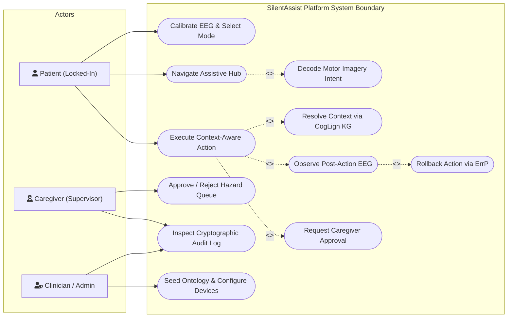
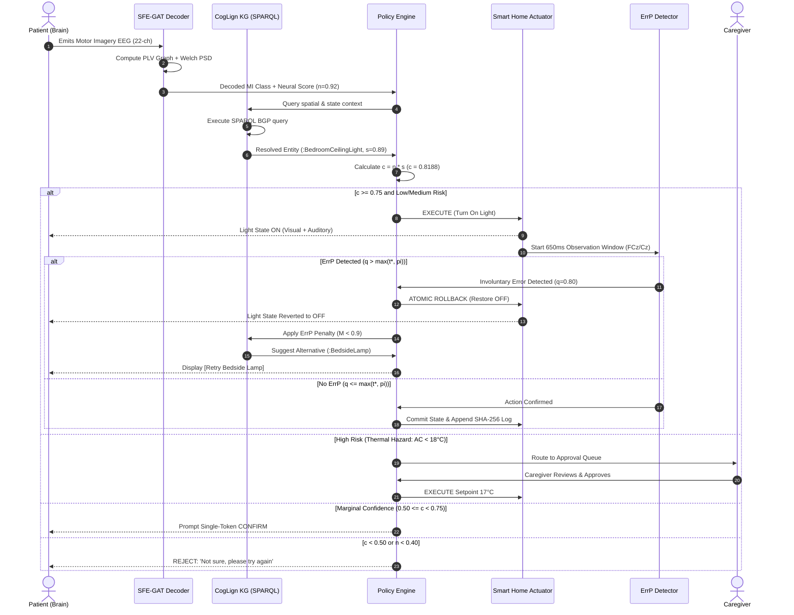
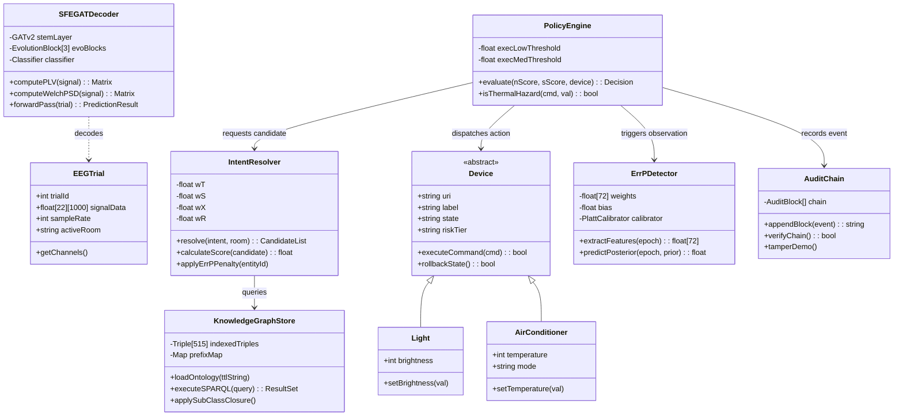
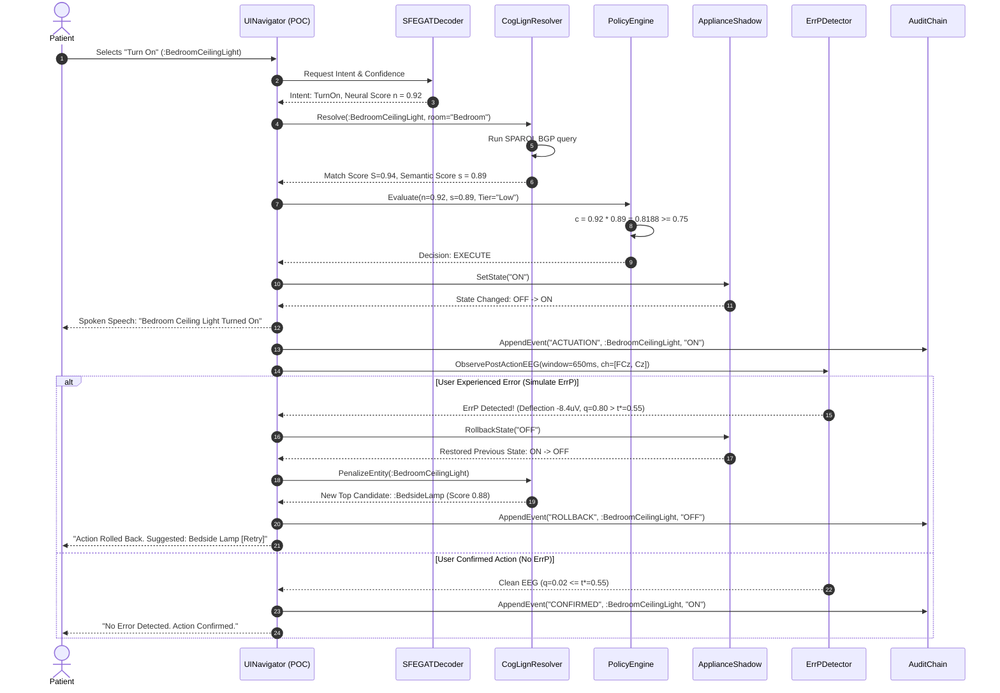
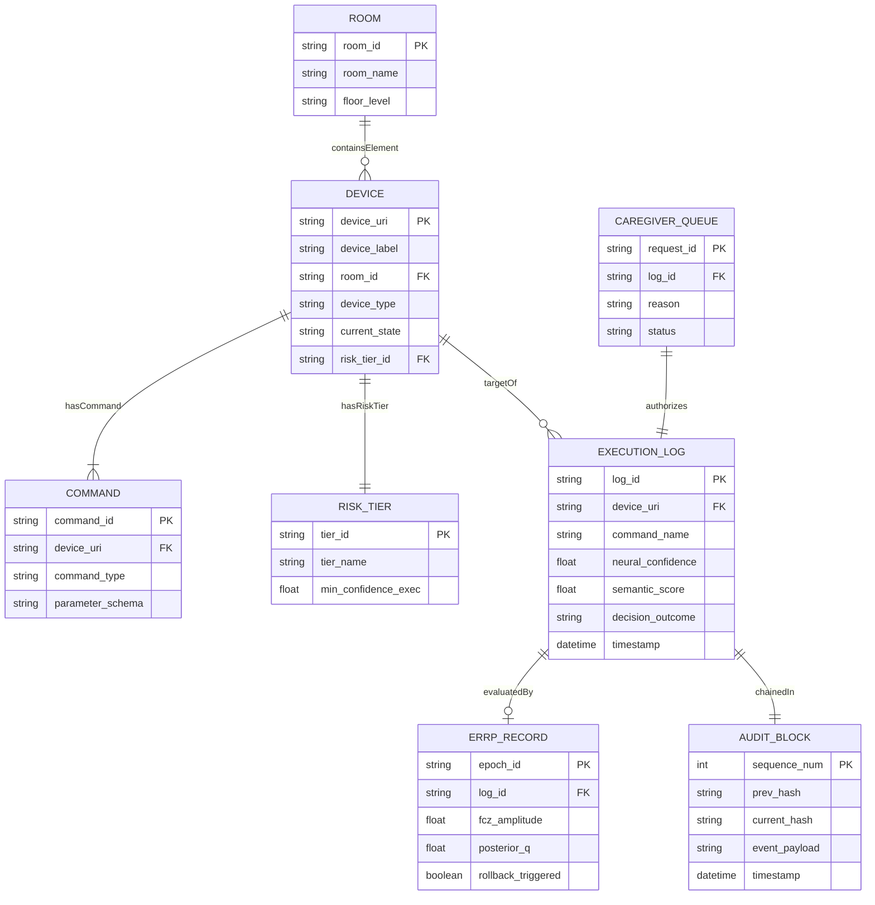
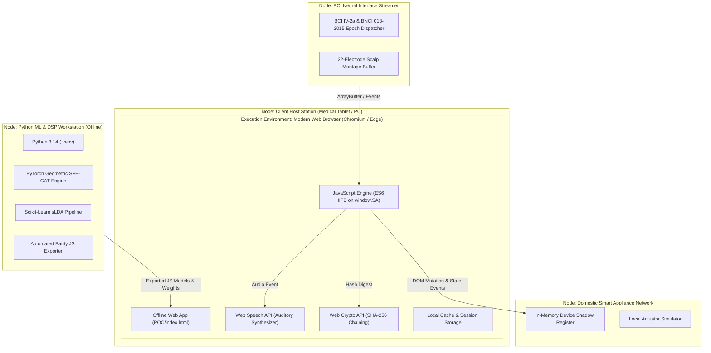
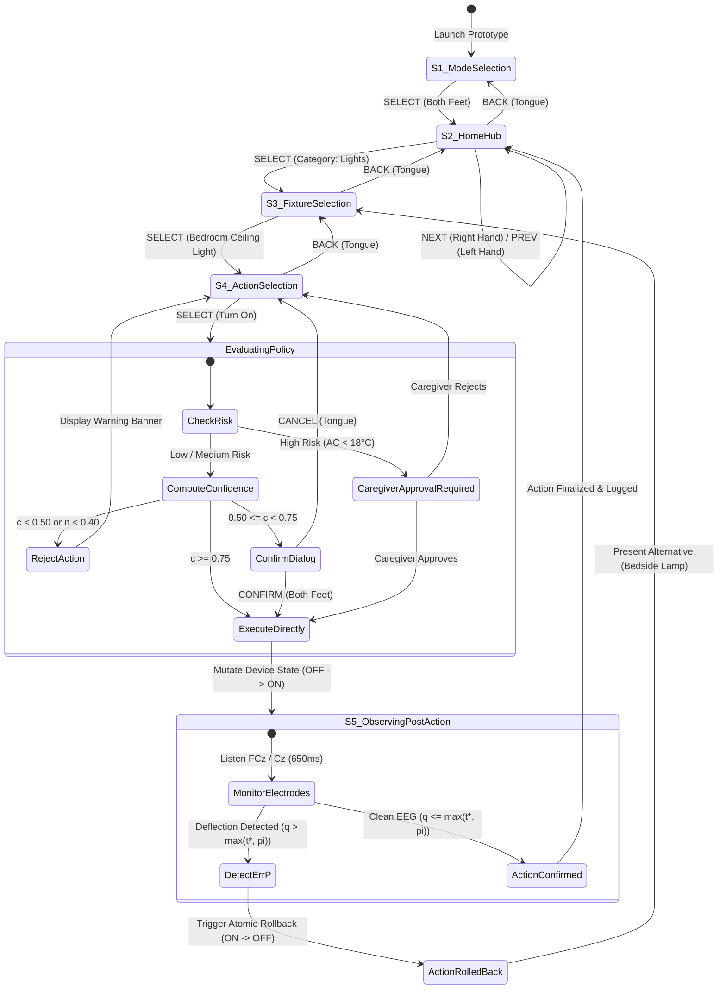
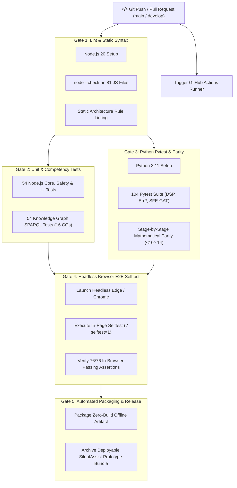

```mermaid
graph TD
    subgraph L1 ["Layer 1: Neural Acquisition & Input Simulation"]
        A1["22-Channel EEG Stream (BCI IV-2a)"]
        A2["BNCI 013-2015 Monitoring ErrP Epochs"]
        A3["Operator Input Simulator (4-Token Nav)"]
    end

    subgraph L2 ["Layer 2: Neurotechnology & Deep Graph Layer"]
        B1["Phase Locking Value (PLV) Hilbert Graph"]
        B2["8-Band Welch PSD Filter Bank (8-40 Hz)"]
        B3["SFE-GAT Deep Neural Network (GATv2 + GAE)"]
        B4["Shrinkage LDA + Platt-Calibrated ErrP Detector"]
    end

    subgraph L3 ["Layer 3: Semantic Reasoning Layer (CogLign)"]
        C1["ETSI SAREF v4.1.1 + W3C BOT RDF Triplestore"]
        C2["Client-Side SPARQL 1.1 Query Engine"]
        C3["Multi-Attribute Candidate Scoring: S(d)"]
        C4["Dynamic ErrP Memory Penalty Modifier"]
    end

    subgraph L4 ["Layer 4: Safety Policy & Governance Layer"]
        D1["Composite Confidence: c = n * s"]
        D2["4-Tier Risk Engine: Low / Medium / High Risk"]
        D3["Thermal Hazard Interceptor (<18°C or >30°C)"]
        D4["Atomic Rollback & Bedside Lamp Suggestion"]
    end

    subgraph L5 ["Layer 5: Presentation & Supervision Layer"]
        E1["6 Accessible Patient Screens (Clinical-Calm Dark UI)"]
        E2["Web Speech API Auditory Feedback"]
        E3["Caregiver Live Shadow Dashboard (Key 'C')"]
        E4["SHA-256 Hash-Chained Tamper-Evident Audit Log"]
    end

    L1 -->|Raw EEG / Trials| L2
    L2 -->|Neural Intent n + Post-Action ErrP q| L3
    L3 -->|Resolved Device & Semantic Score s| L4
    L4 -->|Policy Decision & State Commands| L5
```

# SilentAssist: All Required FYP Midterm Diagrams (Mermaid.js & Eraser.io Prompts)

This document contains the complete diagram specifications for the SilentAssist FYP Midterm Report.

You can render and export these diagrams in two ways:
1. **Mermaid Live Editor:** Copy any ````mermaid```` block into [mermaid.live](https://mermaid.live) and export as PNG/SVG.
2. **Eraser.io AI:** Copy the provided **Eraser.io Prompts** into [eraser.io](https://eraser.io) to generate modern diagram cards.

---

## 1. Figure 2.1: Use-Case Diagram

### Mermaid.js Code


### Eraser.io Prompt
> "Create a formal UML Use-Case diagram for an assistive smart-home BCI called SilentAssist. Primary Actor: Patient with motor impairment (ALS/tetraplegia). Secondary Actor: Caregiver. Admin Actor: Clinician. Inside the system boundary, show use cases: Calibrate EEG & Select Mode, Navigate Assistive Hub, Decode Motor Imagery Intent, Resolve Context via CogLign KG, Execute Context-Aware Action, Observe Post-Action EEG, Rollback Action via ErrP, Request Caregiver Approval, Approve / Reject Hazard Queue, Inspect Cryptographic Audit Log, and Seed Ontology. Use dashed arrows with <<include>> from Execute Action to Resolve Context and Observe Post-Action EEG, and <<extend>> to Rollback Action via ErrP and Request Caregiver Approval."

---

## 2. Figure 3.1: System Architecture Diagram (5-Layer)

### Mermaid.js Code


### Eraser.io Prompt
> "Draw a 5-layer System Architecture diagram for SilentAssist: Adaptive EEG-Based Assistive Home System. 
> Layer 1: Neural Input (22-channel BCI IV-2a stream, BNCI 013-2015 ErrP epochs, Operator simulation). 
> Layer 2: Neurotechnology (Hilbert PLV graph, 8-band Welch PSD filter bank, SFE-GAT GNN decoder, Shrinkage LDA ErrP detector). 
> Layer 3: Semantic Reasoning (SAREF + BOT RDF Triplestore, Client-side SPARQL engine, Multi-attribute resolver S(d), ErrP penalty modifier). 
> Layer 4: Safety & Policy (Composite confidence c = n * s, 4-tier risk engine, Thermal hazard interceptor, Atomic rollback). 
> Layer 5: Presentation & Governance (6-screen accessible UI, Web Speech API voice synthesis, Caregiver supervision dashboard, SHA-256 tamper-evident audit log). Use arrows connecting layers vertically from top to bottom."

---

## 3. Figure 3.2: Activity Diagram (Swimlane Format)

### Mermaid.js Code


### Eraser.io Prompt
> "Create a UML Swimlane Activity Diagram for SilentAssist showing intent navigation, policy gating, and ErrP rollback. Swimlanes: Patient, Neural Decoder, CogLign KG, Policy Engine, Smart Home Actuator, ErrP Detector, and Caregiver. Start with Patient motor imagery. Decoder extracts PLV and PSD, yielding neural score n. KG runs SPARQL returning candidate score s. Policy calculates composite confidence c = n * s. Decision diamond: If High Risk (AC < 18°C), branch to Caregiver queue for approval. If c >= 0.75, send EXECUTE command to Actuator. Actuator changes state and opens 650ms EEG observation window. If ErrP detector flags error (q > t*), execute atomic rollback to previous state, apply penalty to KG, and offer Bedside Lamp alternative. If no ErrP, append confirmed event to SHA-256 audit log."

---

## 4. Figure 3.3: Class Diagram (UML 3-Compartment Format)

### Mermaid.js Code


### Eraser.io Prompt
> "Draw a UML Class Diagram for SilentAssist Core Domain Model in 3-compartment format. 
> Classes:
> 1. EEGTrial (attributes: trialId, signalData, sampleRate; methods: getChannels()).
> 2. SFEGATDecoder (attributes: stemLayer, evoBlocks, classifier; methods: computePLV(), computeWelchPSD(), forwardPass()).
> 3. KnowledgeGraphStore (attributes: indexedTriples, prefixMap; methods: loadOntology(), executeSPARQL()).
> 4. IntentResolver (attributes: wT, wS, wX, wR; methods: resolve(), calculateScore(), applyErrPPenalty()).
> 5. Device (abstract, attributes: uri, label, state, riskTier; methods: executeCommand(), rollbackState()).
> 6. Light (inherits Device, attributes: brightness).
> 7. AirConditioner (inherits Device, attributes: temperature, mode).
> 8. PolicyEngine (attributes: execLowThreshold, execMedThreshold; methods: evaluate(), isThermalHazard()).
> 9. ErrPDetector (attributes: weights, bias; methods: extractFeatures(), predictPosterior()).
> 10. AuditChain (attributes: chain; methods: appendBlock(), verifyChain()).
> Connect Device inheritance, and link PolicyEngine to IntentResolver, Device, ErrPDetector, and AuditChain."

---

## 5. Figure 3.4: Sequence Diagram (Detailed Object Interaction)

### Mermaid.js Code


### Eraser.io Prompt
> "Generate a UML Sequence Diagram showing a complete interaction in SilentAssist with lifelines: Patient, UINavigator, SFEGATDecoder, CogLignResolver, PolicyEngine, ApplianceShadow, ErrPDetector, and AuditChain. Show synchronous message calls: Patient selects Turn On, UINavigator queries Decoder, Decoder returns n=0.92, Resolver returns s=0.89 via SPARQL, PolicyEngine computes c=0.8188 and returns EXECUTE. ApplianceShadow updates state to ON, Web Speech speaks confirmation. Then UINavigator calls ErrPDetector. Include an 'alt' box: Option 1: ErrP Detected (deflection -8.4uV, q=0.80 > t*=0.55) -> ApplianceShadow rolls back to OFF, Resolver penalizes fixture and recommends Bedside Lamp. Option 2: Clean EEG -> Action confirmed and appended to AuditChain."

---

## 6. Figure 3.5: Entity-Relationship Diagram (ERD / Ontology Schema)

### Mermaid.js Code


### Eraser.io Prompt
> "Draw an Entity-Relationship Diagram (ERD) using Crow's Foot notation for a smart-home healthcare system called SilentAssist. 
> Entities:
> - ROOM (PK room_id, room_name, floor_level).
> - DEVICE (PK device_uri, device_label, FK room_id, device_type, current_state, FK risk_tier_id).
> - COMMAND (PK command_id, FK device_uri, command_type, parameter_schema).
> - RISK_TIER (PK tier_id, tier_name, min_confidence_exec).
> - EXECUTION_LOG (PK log_id, FK device_uri, command_name, neural_confidence, semantic_score, decision_outcome, timestamp).
> - ERRP_RECORD (PK epoch_id, FK log_id, fcz_amplitude, posterior_q, rollback_triggered).
> - AUDIT_BLOCK (PK sequence_num, prev_hash, current_hash, event_payload, timestamp).
> - CAREGIVER_QUEUE (PK request_id, FK log_id, reason, status).
> Relationships: ROOM 1:N DEVICE, DEVICE 1:N COMMAND, DEVICE N:1 RISK_TIER, DEVICE 1:N EXECUTION_LOG, EXECUTION_LOG 1:1 ERRP_RECORD, EXECUTION_LOG 1:1 AUDIT_BLOCK, CAREGIVER_QUEUE 1:1 EXECUTION_LOG."

---

## 7. Figure 3.6: Deployment Diagram

### Mermaid.js Code


### Eraser.io Prompt
> "Draw a UML Deployment Diagram for the SilentAssist Assistive BCI Platform. 
> Show four physical nodes as 3D boxes:
> 1. Client Host Station (PC / Medical Tablet) running a Chromium/Edge browser with components: Offline Web App, JavaScript Engine (window.SA namespace), Web Speech API, Web Crypto API, and Local Storage.
> 2. BCI Neural Streamer node running BCI IV-2a and BNCI 013-2015 replay buffers.
> 3. Python Research Workstation running PyTorch Geometric SFE-GAT training, Scikit-Learn sLDA ErrP pipeline, and automated model weight exporter.
> 4. Domestic Smart Appliance Network node with Device Shadow Register and Local Actuator Simulator. Connect them with protocol labels: Memory Bus, Exported JS Data, and PubSub Events."

---

## 8. Figure 4.1: Closed-Loop Navigation & ErrP Rollback State Machine (FSM)

### Mermaid.js Code


---

## 9. Figure 4.2: CI/CD Pipeline & GitHub Actions Flowchart

### Mermaid.js Code


### Eraser.io Prompt
> "Create a modern CI/CD Pipeline Architecture Diagram for GitHub Actions. Top trigger: Git Push or Pull Request to main/develop branches. 
> Show five sequential gates in colored rounded boxes:
> Gate 1: Code Quality & Linting (Syntax check 81 files, architecture constraints).
> Gate 2: Node.js & KG Unit Tests (54 core/safety tests, 54 Knowledge Graph SPARQL competency tests).
> Gate 3: Python & Parity Gate (104 pytest tests, PyTorch vs JavaScript numerical parity with tolerance 1e-14).
> Gate 4: Headless Browser Selftest (Headless Microsoft Edge executing in-page selftest with 76 passing test assertions).
> Gate 5: Automated Deployment & Packaging (Bundling pure offline web prototype zip artifact). 
> Use connecting arrows from Gate 1 down to Gate 5."
